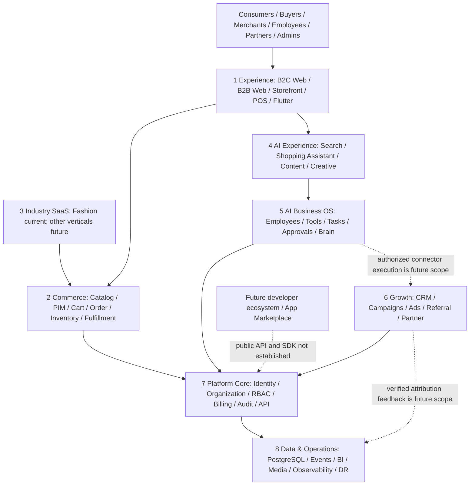

# 02 Product Architecture

**Snapshot:** 2026-10-06. This document separates current repository evidence from target architecture.

## Product Position

Target direction: an AI-Native Commerce & Business Operating System that connects consumers, B2B buyers, merchants, employees, partners, fashion content, and bounded AI workflows. Current verified center of gravity is RUDA Fashion multi-merchant commerce and merchant operations; generalized multi-industry SaaS, operator white-label, public developer marketplace, and autonomous cross-channel marketing are future targets.

## Twelve-Level Product Map

| Level | Product area | Current implementation evidence | Target expansion / gap |
| --- | --- | --- | --- |
| 1 | Consumer / B2C | Consumer store, cart, checkout, orders, account, wishlist components and Consumer API | Full retail funnel, inventory consistency, payment and device E2E |
| 2 | Merchant / B2B | Merchant portal, product/customer/order/inventory/settings APIs | Complete merchant lifecycle and all role/tenant verification |
| 3 | Store / POS | Storefront settings, POS shift/cash movements, sales and return paths | Multi-store, terminals, staff tills, reconciliation and omnichannel stock |
| 4 | Industry SaaS | Fashion workflows, production/material/procurement and Industry metadata | Generic industry schema/extension framework; not currently a multi-industry product |
| 5 | AI Layer | Provider adapters, AI support, product copy/import/image drafts, limited retrieval | Governed provider capability registry, measured cost/quality, all-route billing |
| 6 | AI Agent Layer | `ModaGptTask`, bounded tools, approvals, audit, low-inventory review | General planner/executor/verifier, durable workflow resume/cancel and agent registry |
| 7 | Marketing / Growth | Growth Mission, CRM follow-ups, campaign/channel UI, referral metrics | Consent-safe outbound automation, ad connectors, spend attribution |
| 8 | Affiliate / Distribution | Partner, referral, campaign and commission ledger | Multi-level contracts, fraud rules, settlement/payout and cross-market tax |
| 9 | Marketplace | Existing multi-merchant catalog/store discovery and B2B commerce | Open service/provider marketplace, dispute/SLA and ecosystem operations |
| 10 | Payment / Billing / Settlement | Stripe/PayPal/Solana commerce paths, Stripe ModaGPT subscription, manual payout records | Complete marketplace finance, reconciliation, VAT, multi-currency settlement/payout |
| 11 | Data / Analytics / BI | Admin BI, merchant sales/inventory reports, Growth metrics | Semantic metric layer, warehouse, data lineage and cross-domain cohort truth |
| 12 | Platform / API / Developer | Internal REST API and provider integrations | Public versioned API, OAuth app install, SDK, webhooks, developer portal/App Marketplace |

## Eight-Layer Target Architecture

Solid arrows show code-level relationships or intended current data boundaries; they do not prove every end-to-end flow has passed production acceptance. Dashed arrows are target capabilities.

## Architecture Decisions / Constraints

- PostgreSQL/Prisma business records remain authoritative for customer, product, order, payment, refund and commission facts.
- AI reads through bounded, server-authorized tools; model output never sets tenant, permissions, price, payment truth or inventory truth.
- External execution starts read-only/draft-first and requires explicit scopes, consent, approval and budget limits.
- Marketplace, public API, multi-industry SaaS and operator white-label are separate product phases, not implications of the current multi-merchant catalog.

## Current and Target Boundaries

Current code has fashion-specific domain workflows and partial shared services. There is not enough repository evidence for a generalized plugin architecture, public developer contract, full customer-data platform, multi-industry tenant plane, or production-grade autonomous campaign engine. Treat these as future architecture work requiring product owners, contracts, security review, data migration plan and acceptance gates.
