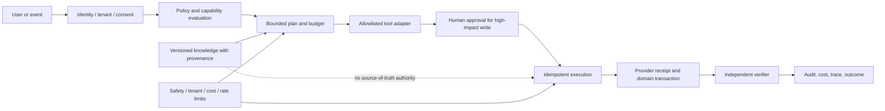

# 06 AI Architecture

**Snapshot:** 2026-10-06. AI runtime inventory and target control plane.

## Current AI Code Surface

- Provider selection/circuit breaking under `src/server/aiEmployeeProviders.ts` and `aiProviderCircuitBreaker.ts`; repository dependencies include Google GenAI, Fal, and other provider integration packages.
- ModaGPT Brain, runtime, core employee registry, orchestration/workflow, task queue, worker, supervisor, tools and approvals under `src/server/modagpt*.ts` and `aiEmployee*.ts`.
- Merchant assistant/support has intent parsing, capability registry, attachment/date range, knowledge and feedback modules.
- Product workflows include AI copy/import/creative drafts and storefront/public assistant code.
- Billing/entitlements/credit reservation code exists, with coverage only on selected flows.
- Fashion Ingestion's `analyze_content()` and `generate_copy()` return deterministic local results and label the provider `mock`; do not count this as a live model integration.

## Current Capability Status

| Capability | Evidence | Status |
| --- | --- | --- |
| Model/provider abstraction | Provider registry and circuit breaker modules | PARTIAL; runtime config/live behavior not accepted |
| Merchant assistant | Intent/capability/history/knowledge modules | PARTIAL; per-intent coverage and factual grounding need acceptance |
| Product creative | Draft and provider modules, media validation | PARTIAL; provider, cost, rights, review and publish end-to-end unknown |
| Brain memory/knowledge | Persisted documents/chunks/facts/evaluations/feedback models | PARTIAL; retrieval quality, provenance, deletion and tenant isolation need proof |
| Durable tasks | Queue, worker, supervisor, task/approval persistence and tests | PARTIAL; outage/redeploy/retry/idempotency operations need proof |
| Human approval | Approval models and selected high-impact tasks | PARTIAL; universal action policy and UI audit not established |
| AI billing | Plans, invoices, entitlements, credits/reservations | PARTIAL; not all provider calls are demonstrably metered |
| Autonomous Growth | Mission planning, reviews, CRM follow-up records | PARTIAL; external channel execution and attributed business lift not established |
| Fashion content classifier | Local heuristic/deterministic implementation | MOCK |
| Public autonomous agent platform | No full documented API/tenant/plugin lifecycle evidence | MISSING / future scope |

## Target AI Control Plane

## Mandatory Invariants

- Model output is untrusted input. Server determines actor, tenant, allowed resource IDs, price, stock, permission, approval requirement and idempotency scope.
- Retrieval returns provenance and freshness. Every consequential answer distinguishes retrieved facts from inference and unknowns.
- Read-only and draft-only are defaults. Any external or irreversible write requires explicitly granted capability, valid consent, bounded payload, appropriate approval and a durable receipt.
- Agents may not modify the financial, payment, inventory or access-control source of truth outside existing domain services.
- A workflow stores input/output schema versions, provider/model, tool versions, policy result, attempts, actor, tenant, approval, provider receipt, usage/cost, verification and final disposition.
- Credit reservation is atomic before model work; release on failure/cancel; consume only according to persisted provider usage policy; reconcile actual provider spend.
- Task workers require lease ownership/fencing and per-effect idempotency. Retry cannot duplicate orders, messages, charges or media publication.
- User data and embeddings obey consent, retention, export/delete and tenant isolation.

## Gaps to Close

1. Publish one AI capability matrix keyed by actor × tenant × role × tool × read/write × approval × consent × plan/credit.
2. Enumerate every model invocation and provider fallback; fail closed when a required real provider is unavailable rather than silently returning plausible mock output.
3. Measure answer correctness, tool correctness, groundedness, refusal/permission violations, latency, provider error, token cost and successful business outcome.
4. Add worker failure drills: duplicate lease, process termination, DB outage, provider timeout/rate limit, redeploy, cancel, dead letter and recovery.
5. Add per-tenant model budgets, concurrency limits, timeout and emergency kill switch.
6. Treat memory as versioned derived data with source refs, decay, correction, access/deletion policy and cross-tenant leakage tests.
7. Complete deterministic evaluation datasets for commerce, support, fashion content and each agent role; include adversarial tool escalation.
8. Record provider/model/version/region and data-processing disclosure for privacy and incident review.

## Release Gate

No agent is marked production-ready until its exact persona, supported workflows, forbidden actions, permission tests, approval path, budget, outage behavior, human escalation, evaluation score and production telemetry have named owners and passing evidence.
