# 07 AI Marketing Architecture

**Snapshot:** 2026-10-06. Current Growth/CRM records are distinguished from external marketing execution.

## Current Evidence

- Growth domain modules include mission planning/review, worker center, attribution and CRM follow-ups.
- Prisma migration names show marketing events, daily metrics, partner growth, follow-ups and automation keys.
- Admin/merchant UI and route code exist for selected campaign, partner and Growth operations.
- `metaPublishing.ts` and provider modules indicate integrations/code paths, but repository presence does not prove Meta publishing credentials, scopes, app review, delivery or analytics are active.
- Previous code inventory contains an explicit `not_implemented` Growth channel status. This is a real boundary, not a reason to fabricate channel completion.

## Current Lifecycle Assessment

| Stage | Status | Evidence required to mark complete |
| --- | --- | --- |
| Customer/merchant segment and consent | PARTIAL | Consent source, purpose, channel preference, suppression and deletion tests |
| Campaign/mission draft | PARTIAL | Persisted owner, version, objective, audience and constraints |
| Approval | PARTIAL | Approver identity, immutable approved payload/version and expiry |
| Channel connection | PARTIAL | Provider app review, least-privilege OAuth scope, expiry/revoke and tenant ownership |
| Scheduled send/publish | PARTIAL / some channels not implemented | Durable outbox, provider receipt, retries, cancellation and duplicate prevention |
| Event collection | PARTIAL | Signed provider event, canonical event identity, late/duplicate rules |
| Attribution | PARTIAL | Click/referral/session to verified order/payment matching and attribution window |
| ROI and AI optimization | PARTIAL | Currency/cost/fee/refund/revenue denominators, experiment control and causal caveats |
| Autonomous budget actions | NOT RELEASED | Explicit cap, dual approval, kill switch, holdout and audited execution |

## Target Campaign Flow

```mermaid
flowchart LR
  signal[Verified business signal] --> segment[Consent-aware segment]
  segment --> draft[AI draft with source and policy]
  draft --> approval[Human approval and budget]
  approval --> outbox[Versioned campaign outbox]
  outbox --> connector[Scoped provider adapter]
  connector --> receipt[Delivery receipt / provider event]
  receipt --> attribution[Click and verified commerce event]
  attribution --> metric[Cost, net revenue, returns, cohort]
  metric --> review[Human-reviewed learning]
  review -. bounded recommendations only .-> draft
```

## Required Safety and Commercial Contracts

- Consent is purpose- and channel-specific. Honor unsubscribe, suppression, legal basis, local time windows and regional rules.
- Never infer consent from a purchase, partner referral, imported contact or AI conversation.
- Draft generation is separated from publishing; each approved payload is immutable and bound to channel, account, tenant, audience, budget and schedule.
- OAuth tokens are encrypted, scoped, revocable, tenant-bound and never exposed to the model or logs.
- Connector sends use idempotency/outbox state and persist provider receipt IDs. Retrying a timeout must first check delivery status.
- Attribution distinguishes gross sales, net sales, refunds/returns, fees, ad spend and currency. Unknown/missing attribution is not silently forced to a campaign.
- AI recommendations are not causal proof. Use holdout/experiment design before automated optimization claims.
- Include per-tenant/day campaign and spend caps, channel kill switch and fraud/abuse alerts.

## Top Gaps

1. Replace free-form channel states with capability discovery, OAuth verification, account/tenant connection state, supported operation and health.
2. Ensure `GrowthMarketingEvent` has canonical source/provider IDs, signed ingestion, replay policy and deduplication.
3. Link campaign/referral to a verified paid order and net value via stable attribution IDs; document windows and precedence.
4. Add outbox, retry/dead-letter, provider receipt and cancellation for channel execution.
5. Add approval versioning and invalidate approval on any audience/content/budget/schedule mutation.
6. Add privacy: consent ledger, exports/deletion, retention and suppression propagation.
7. Add channel-level reporting with explicit freshness and connector failure state.
8. Automate nothing that spends money or contacts customers until the above controls and human approval are accepted.
