# 09 Marketplace Architecture

**Snapshot:** 2026-10-06. The existing multi-merchant commerce catalog is not the same product as a public services, app or agent marketplace.

## Current Marketplace-Like Capabilities

- Multi-merchant storefront/catalog and B2B buyer order/quote paths.
- Merchant self-service storefront and product/catalog features exist in code/migrations.
- Partner referrals and commission ledger support a distribution model.
- Product listing, inventory, orders, promotions, fulfillment, reviews/support and payments have repository models/routes.

Status: PARTIAL commerce marketplace foundation. Full production marketplace acceptance is not established by schema/route existence or one successful login.

## Marketplace Product Types (Keep Separate)

| Product | Current status | Core contract |
| --- | --- | --- |
| Multi-merchant retail/B2B marketplace | Existing partial commerce surface | Merchant onboarding, product compliance, buyer protection, orders, payments, fulfillment, returns and settlement |
| Service provider marketplace | No complete implementation established | Provider onboarding, service catalog, booking/SLA, cancellation/disputes and payouts |
| Developer App Marketplace | Future | App review, OAuth, scopes, data handling, versions, pricing, support and revocation |
| AI Agent Marketplace | Future | Agent identity, signed capability package, sandbox, tenant consent, tool policy, usage/billing and incident control |
| Partner referral network | Existing partial | Contracted attribution and commission ledger; not equivalent to third-party executable apps |

## Target Commerce Lifecycle

```mermaid
flowchart LR
  apply[Merchant application] --> verify[Identity, business and product verification]
  verify --> catalog[Versioned catalog / price / stock]
  catalog --> discover[Search, categories and ranking]
  discover --> purchase[Quote / cart / order]
  purchase --> payment[Verified payment event]
  payment --> fulfill[Reservation / shipment / tracking]
  fulfill --> care[Return / refund / dispute]
  care --> ledger[Fees / commission / settlement ledger]
  ledger --> review[Verified purchase review and analytics]
```

## Commerce Marketplace Invariants

- Merchant ownership is checked for every seller-side object, including nested items, uploads, invoices and provider config.
- SKU, price, promotion and stock are re-read/validated server-side at checkout; never trust client totals or AI recommendations.
- Order placement and stock reservation are atomic/idempotent; payment confirmation comes only from verified provider events.
- Seller payout is based on reconciled eligible net proceeds after fees, refunds, chargebacks and holds.
- Listing media must retain owner, rights/license, moderation, watermark and removal metadata.
- Reviews are tied to eligible fulfilled purchases or explicitly labeled otherwise; abuse/report/moderation and appeal process exist.
- Marketplace ranking and AI recommendations disclose relevant sponsored/commission relationships and avoid unlawful discrimination.

## Gaps

- Complete seller/business verification, risk tiers, sanctions/region rules and recurring review.
- Explicit marketplace terms, buyer protection, SLA, dispute/chargeback and refund operations.
- Multi-merchant order split/fulfillment, tax/shipping allocation and partial cancellation/refund.
- Platform fee, commission, reserve/hold, settlement and payout reconciliation by currency.
- Search relevance, catalog quality, availability, fraud and marketplace health metrics.
- Merchant offboarding, data export, open orders/refunds, media deletion and financial retention handling.
- Public API/App Marketplace remains a separate future product; must not expose internal Express routes as a public developer contract.
