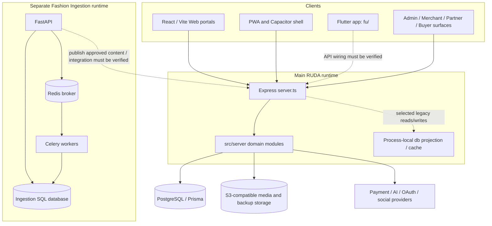

# 13 System Architecture Audit

**Snapshot:** 2026-10-06. Current architecture shown from repository boundaries; dashed links are intended/integration edges requiring operational proof.

## Current System Diagram

## Runtime Composition and Risks

- `server.ts` is a large composition root containing route declarations, middleware, database wiring and legacy compatibility paths. This makes route ownership, dependency boundaries, lifecycle and full policy coverage hard to establish.
- Some production code hydrates a process-local projection from PostgreSQL; legacy/read paths may not be transactionally consistent and multi-instance cache invalidation is not established.
- Web and API are bundled together for production; the repo uses PM2 and a guarded production start script.
- The ingestion service has its own DB, migrations and Redis/Celery queue. It is a separately deployed failure domain; a publishing/API contract and replay/de-dup rules are required.
- Flutter has a large plugin footprint and separate environment/build configuration. Current API/auth/payment compatibility is not proven by dependency inventory.
- Media, financial providers and AI providers are external failure domains; each needs timeout, idempotency, receipt, retry and operator alerts.

## Top 10 Architecture Problems

1. Overloaded `server.ts` increases coupling and makes exhaustive route policy assurance difficult.
2. Process-local `db` projection duplicates PostgreSQL truth and is a multi-process staleness risk.
3. Permission/tenant checks are route-local rather than proven by a generated route-capability inventory.
4. No complete event/outbox contract is established for external side effects and cross-domain workflows.
5. Payment, commission, settlement and subscription reconciliation are separate but not proven end-to-end operationally.
6. AI task queue reliability and provider cost reconciliation are only partial despite durable schema/modules.
7. No unified observability contract across HTTP, task, provider, ingestion, payment and tenant.
8. Ingestion-to-main publishing and media lifecycle are separate DB/object-store boundaries without proven end-to-end recovery.
9. CI/release automation evidence is narrow: Codemagic iOS only; no GitHub Actions workflow found in this scan.
10. No validated multi-region, horizontal-scale, data residency, RPO/RTO or disaster recovery evidence was run in this task.

## Recommended Boundary Evolution

- Keep Express API stable while extracting ownership by domain behind explicit service interfaces; avoid a large rewrite.
- Define Prisma transaction boundaries and transactional outbox for payment, fulfillment, CRM and AI side effects.
- Make process-local projection read-only where possible; enumerate and migrate writes/read dependencies before scaling replicas.
- Treat ingestion as an independent service with authenticated versioned publish API and event-based retry.
- Add shared request/task/provider correlation fields and metrics without leaking secrets/PII.
- Define a single deployment topology and environment matrix for Web, Flutter, ingestion, DB, Redis, storage and providers.
