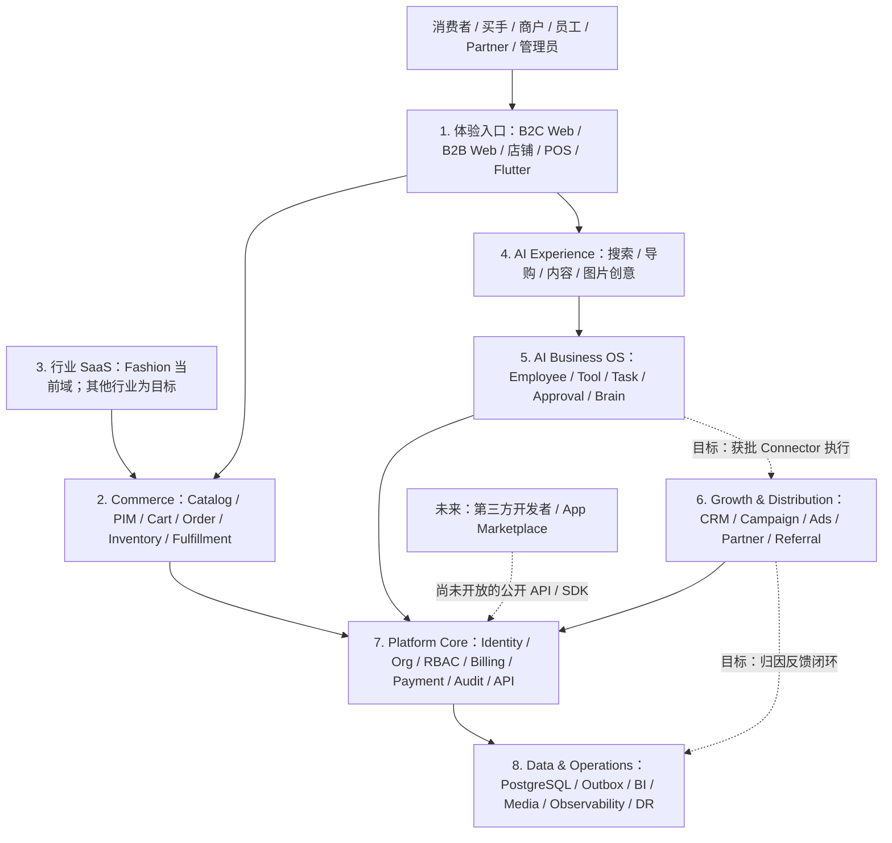

# RUDA Fashion 真实功能知识库总览

## 1. 文档目的

本文件是 RUDA Fashion 唯一的产品/工程功能知识库，合并原有 Growth OS、工程闭环、权限/状态机、ModaGPT、Billing、Fashion Community、缺口与验收文档的内容，并对照当前工作区代码说明真实状态。重叠内容已统一口径，不再把其他功能规格文档作为本文件的正文依赖。它回答三个问题：

1. 我们现在到底有哪些“真功能”？
2. 哪些功能只是文档或半成品？
3. 当前上线范围里，哪些是已经闭环、哪些还差？

## 最新全仓架构审计

2026-10-06 全仓只读代码审计与阶段一验收材料位于 `docs/audit-2026-10-06/`。该审计只记录仓库证据，不代表生产环境已验收，也不启动业务代码实现。

- [01 当前系统审计](audit-2026-10-06/01_CURRENT_SYSTEM_AUDIT.md)
- [02 产品架构](audit-2026-10-06/02_PRODUCT_ARCHITECTURE.md)
- [03 功能缺口](audit-2026-10-06/03_MISSING_FEATURES.md)
- [04 数据架构](audit-2026-10-06/04_DATA_ARCHITECTURE.md)
- [05 身份与权限](audit-2026-10-06/05_IDENTITY_PERMISSION.md)
- [06 AI 架构](audit-2026-10-06/06_AI_ARCHITECTURE.md)
- [07 AI 营销架构](audit-2026-10-06/07_AI_MARKETING_ARCHITECTURE.md)
- [08 Partner Agent 架构](audit-2026-10-06/08_PARTNER_AGENT_ARCHITECTURE.md)
- [09 Marketplace 架构](audit-2026-10-06/09_MARKETPLACE_ARCHITECTURE.md)
- [10 财务架构](audit-2026-10-06/10_FINANCIAL_ARCHITECTURE.md)
- [11 全球化架构](audit-2026-10-06/11_GLOBALIZATION.md)
- [12 开发者平台](audit-2026-10-06/12_DEVELOPER_PLATFORM.md)
- [13 系统架构审计](audit-2026-10-06/13_SYSTEM_ARCHITECTURE.md)
- [14 工程路线图](audit-2026-10-06/14_ROADMAP.md)
- [15 最终缺口报告](audit-2026-10-06/15_FINAL_GAP_REPORT.md)
- [16 最终验收清单](audit-2026-10-06/16_FINAL_ACCEPTANCE.md)

合并范围：项目功能蓝图、功能总清单、工程实现状态、缺口与上线门禁、权限矩阵、状态机/审计规范、ModaGPT 路线/Brain/队列、Billing Runtime、Fashion/Tik 创作、根 README 中的生产/备份说明、宝塔部署流程及 Fashion Ingestion 服务说明。研发工具技能文件不属于 RUDA 产品规格。

---

## Executive Truth Layer — 2026-10-06

本区是研发、QA、运营、商户和 AI 助手的发布事实摘要。它把“代码存在”“测试通过”和“生产发布”分开；没有证据的字段写“未知/待验收”，不推测通过。Owner 尚未从仓库事实确定的条目统一标“待指定”。

### 0.1 统一发布阶段

`Blueprint → Code → Local Test → Isolated Integration → Staging → Production Smoke → Released`

每次升级都须记录环境、日期、命令/证据、已知失败和 Owner。没有证据就停留在当前阶段。

### 0.2 Feature Release Matrix

| 功能域 | UI / API / DB 入口 | 当前最高证据 | 最后验证 / 环境 | Owner | 主要未决项 |
| --- | --- | --- | --- | --- | --- |
| Auth / Admin | `server.ts` auth、AuthAccount、AdminTwoFactor | 生产单次管理员登录成功；安全门禁未通过 | 2026-10-06，线上单次请求 | 待指定 | 凭证轮换、MFA 强制、白名单 fail-closed、弱密码与会话撤销 |
| B2B Buyer / Company | frontend checkout/orders、buyer/company auth/order API | Code | 2026-10-06 静态扫描；无全流程 E2E | 待指定 | 注册→下单→支付→取消/退货目标环境验收 |
| C 端 Consumer | `src/apps/shared/components/consumer`、`/api/consumers/*` | Code | 2026-10-06 静态扫描；结账未实测 | 待指定 | Consumer 身份、支付和订单端到端验收 |
| Merchant / Employee | `MerchantPortal`、merchant routes、tenant/permission guards | Code + 局部测试 | 历史专项测试；无全模块生产矩阵 | 待指定 | 全角色与 merchant A/B 负向访问测试 |
| Product / SKU / Storefront | product/category/variant routes、Product/ProductVariant | Code + 局部测试 | 单流程测试记录；未全量生产抽检 | 待指定 | 发布/媒体/CDN/多语言数据一致性 |
| Inventory / Warehouse | InventoryBalance/Movement、StockReservation/Transfer | Code + 局部测试 | 历史 isolated tests；目标库未重查 | 待指定 | POS/采购/生产账本对齐、多进程缓存一致性 |
| Order / Fulfillment / Shipment | Order、FulfillmentShipment、tracking routes | Code + 局部测试 | 历史单测；无真实承运商回执证据 | 待指定 | 下单→拣货→发货→物流回执 E2E |
| Payment / Refund / Return | PaymentTransaction/WebhookEvent、RefundTransaction、ReturnRequest | 隔离 PG/HTTP 局部验证 | 历史 P0 集成记录；真实 Provider 未验收 | 待指定 | sandbox、验签/重放、退款、对账、失败补偿 |
| RFQ / Quote | SalesQuote、Buyer/Merchant RFQ、quote routes | 隔离 PG 局部验证 | 历史测试；邮件使用 mock，未证实送达 | 待指定 | 真实测试邮箱、陈旧报价、并发/失败端到端验收 |
| POS | Smart POS、MerchantPosShift/CashMovement | Code + E2E 测试文件 | E2E 文件存在；本次未执行 | 待指定 | 真实收银、班次现金核对、退货/结班账务 |
| Procurement / Production | PurchaseOrder/Receipt、Material、WorkOrder/Report | Code + 局部单测 | 本次未运行 PostgreSQL 全流程 | 待指定 | 收货、物料/BOM、报工和库存联动 |
| Partner / Referral / Commission | Partner、Referral、Commission Ledger | 隔离 PG/HTTP 局部验证 | 历史 suites 记录；未验证真实 payout | 待指定 | 完整层级范围、生产并发、付款与对账 |
| Growth Mission / CRM | GrowthMission/FollowUp/Worker routes | 隔离 PG/HTTP 局部验证 | 历史测试；官方 Connector 闭环未完成 | 待指定 | Mission→渠道回执→订单/成本归因 |
| AI Employee / Brain / Queue | ModaGptTask、Brain models、employee tools | 隔离 PG 局部验证 | 历史 suites；本次未重跑 | 待指定 | 全工具权限、重启/取消/告警及向量服务 |
| ModaGPT Billing / Credits | Stripe checkout/webhook、credit ledger/reservation | 隔离 PG 局部验证 | 无 Stripe Test/Live account acceptance | 待指定 | 退款/credit reversal、实际成本账、税务及 Live gate |
| Fashion Community / Tik | Feed/post/media/identity routes + models | Code + 局部单测 | 迁移、对象存储和生产发布未重验 | 待指定 | 导入 count、CDN、删除/身份关联 E2E |
| Flutter | `fu/` Flutter app | Code | 未运行 analyze/build/设备验收 | 待指定 | API/Auth/Payment/Push、Android/iOS 发布验证 |
| Fashion Ingestion | FastAPI/Celery/SQLAlchemy service | Code | 本次未运行 Docker/pytest/provider test | 待指定 | 授权源、Worker、审核和发布接口 E2E |
| Backup / DR | DB/media backup、cloud sync、recovery drill | 工具代码存在 | 当前无可引用的成功恢复报告 | 待指定 | 隔离恢复实测、RPO/RTO 计时和清理验收 |
| Platform Admin | Admin nav/routes/settings/database center | Code + 局部 integration | 仅登录有 2026-10-06 单次生产证据 | 待指定 | 各模块权限、业务副作用及生产 smoke |

### 0.2.1 Feature Acceptance Ledger

以下是逐域验收台账，不把代码搜索计数当功能完成数。Feature ID 是知识库追踪 ID，不表示数据库或产品里已有同名 ID。未发现证据的单元格标为“未验收”。

| Feature ID / 功能 | UI → API/Service → DB | Permission / State / Audit | Tests / External Dependency | Production Evidence / Owner / Last Verified |
| --- | --- | --- | --- | --- |
| F-AUTH：身份认证 | Auth shells → `/api/auth/*` → AuthAccount/AccountIdentity | role/credential guards；Admin IP/可选 TOTP；登录 audit | 有 CSRF/tenant/phase0 相关测试；未发现 admin MFA/会话撤销专用 integration | Admin 一次登录成功；其他角色未知。Owner 待指定；2026-10-06 |
| F-B2B：买手与企业交易 | buyer/account/checkout/orders → auth/orders/payments → Customer/Company/Order/Payment | buyer/company owner scope；订单/付款状态；audit 覆盖待逐路由核查 | 有 cart/provider/promotion 单测和 P0 webhook 测试；真实 Provider sandbox 未验收 | 生产下单全链路未知。Owner 待指定；2026-10-06 代码扫描 |
| F-CONS：C端消费者 | `consumer_*` views → `/api/consumers/*`/checkout API → Consumer/Order | consumer self-scope；零售订单状态；与 B2B 身份隔离 | 本轮未发现 Consumer purchase E2E；支付 Provider 依赖未验收 | 未知。Owner 待指定；未做目标环境验证 |
| F-MERCH：商家与员工 | MerchantPortal/Employee app → `/api/merchant/*` → Merchant/Employee/Audit | merchantId + per-permission + object owner；各写状态需逐路由核实 | 有 employee permissions、tenant access、domain tests；全路由负向覆盖未知 | 未完成全商户角色生产抽验。Owner 待指定；2026-10-06 代码扫描 |
| F-PROD：商品/SKU/店铺 | Products/SKU/content → merchant/admin product routes → Product/ProductVariant/Category | merchant scope、product.publish、review/status、部分 audit | 有 product intake/zone/AI workflow tests；媒体/CDN 为外部依赖 | 商品编辑/发布生产抽样未知。Owner 待指定；2026-10-06 代码扫描 |
| F-INV：库存/仓库 | Inventory/SKU views → balances/movements/adjustments → InventoryBalance/Movement/Reservation | warehouse permissions、merchant scope、append movement/audit | 有 single-warehouse/AI inventory/unit suites；跨 POS/采购/生产 E2E 未验收 | 单仓 schema/生产余额需只读核查。Owner 待指定；历史测试，当前目标库未知 |
| F-ORDER：订单/履约/物流 | buyer/merchant order views → order/fulfill/shipment/tracking routes → Order/Shipment/Tracking | buyer/merchant ownership、状态转换、audit | 有 merchant fulfillment/idempotency tests；无真实 carrier callback 证据 | 目标环境履约链路未知。Owner 待指定；未做当前 smoke |
| F-PAY：支付 | checkout/payment UI → Stripe/PayPal/Solana/webhook routes → PaymentTransaction/WebhookEvent | buyer/order owner、签名、幂等、金额/币种校验 | 有 provider/Solana 单测和 P0 custom webhook isolation；真实 provider accounts 未验收 | 不可宣称生产收款闭环。Owner 待指定；历史隔离测试 |
| F-REFUND：退款/退货 | order/merchant finance → refund/return routes → RefundTransaction/ReturnRequest | order/payment ownership、合法状态、commission reversal/audit | merchant-refunds + P0 webhook integration 局部覆盖；完整 provider 对账缺失 | 银行/Provider 实际退款结果未知。Owner 待指定；历史隔离测试 |
| F-SHIP：Shipment | Merchant orders → shipment/tracking API → FulfillmentShipment/TrackingEvent | merchant owns order/shipment、warehouse.ship、state/audit | merchant-fulfillment 单测；carrier API 为外部依赖且未验收 | 仅有代码路径，无真实承运商回执证据。Owner 待指定；代码扫描 |
| F-RFQ：RFQ/Quote/OCR | Buyer/Merchant RFQ & quote → quote/OCR APIs → SalesQuote/Items | linked buyer、merchant ownership、approval snapshot、currency、audit | modagpt-quote isolated tests；邮件 adapter 历史用 mock | 真实邮件送达和线上买家确认未知。Owner 待指定；历史集成 |
| F-POS：POS | MerchantSmartPos → POS shift/sale/return APIs → MerchantPosShift/CashMovement/Order | sales.order.create、return.manage、shift状态、cash audit | POS journey E2E 文件存在；本轮未运行 | 现场收银/现金对账未知。Owner 待指定；未执行 E2E |
| F-PROC：采购/收货 | Procurement workspace → purchase order/receipt APIs → PurchaseOrder/Receipt/Items | production/warehouse permissions、状态、inventory movement/audit | merchant-procurement tests；供应商实单外部流程未验收 | 未做完整生产验收。Owner 待指定；代码/单测层 |
| F-MFG：物料/生产 | Materials/Production pages → inbound/work-order/report APIs → Material/WorkOrder/Report | production.report、商家 scope、状态/审计 | 有局部 domain tests；BOM 消耗/成本/库存联动 E2E 缺失 | 目标环境生产工单闭环未知。Owner 待指定；未验收 |
| F-PARTNER：Partner/Referral/Commission | PartnerPortal/AdminPartnerGrowth → partner/referral/commission APIs → Partner/Referral/Ledger/Audit | Partner hierarchy scope、admin permission、owner/source、ledger transitions | partner-growth/commission P0 integration 有历史记录；所有组织层级组合未验收 | production identity/真实付款结算未知。Owner 待指定；历史隔离测试 |
| F-GROWTH：Growth/CRM/Campaign | AdminGrowthCenter/merchant growth → Mission/CRM/channel APIs → GrowthMission/Event/FollowUp | Platform scope、审批、consent、幂等/audit | growth-crm/mission/worker integration 有历史记录；无完整 Connector E2E | 无可证明的真实广告/外发闭环。Owner 待指定；历史隔离测试 |
| F-AIEMP：AI Employee | AI center/merchant AI pages → employee/tool APIs → definition/installation/audit/drafts | installation + merchant + tool permission + consent/approval | AI employee/permissions/runtime suites；外部模型依赖未知 | 生产 Provider 可用性未知。Owner 待指定；局部测试 |
| F-BRAIN：Brain / Task Queue | Merchant knowledge/task UI → Brain/task APIs → ModaGptTask/Brain models | tenant-first retrieval、review permission、lease/idempotency/audit | Brain/task isolated PostgreSQL suites 有历史记录；完整 worker restart 缺失 | feature flag/schema/provider 的线上状态待查。Owner 待指定；历史集成 |
| F-BILL：ModaGPT Billing/Credits | plan/pricing/admin billing UI → Stripe checkout/webhook → Subscription/Invoice/Payment/CreditLedger | owner-only subscription actions、signed webhook、idempotency | modagpt-billing isolated tests；没有 Stripe Test/Live acceptance | Checkout 默认 fail-closed；Live billing 未验收。Owner 待指定；历史测试 |
| F-COMM：Fashion Community/Tik | community/feed/creator UI → fashion/social/moderation APIs → FashionAccount/Post/Comment/Reaction | creator session、投稿/审核权限、媒体 owner、audit | hashtags/feed/video 单测；导入/对象存储需另验 | 生产迁移、S3/CDN、身份关联未知。Owner 待指定；代码/单测层 |
| F-ADMIN：平台后台 | PlatformAdmin/Desktop+Mobile → admin routes → business/config/audit models | admin auth + IP + per-route permission (覆盖待盘) | admin-navigation 与 P0 部分 HTTP tests；全后台 E2E 缺 | 仅 admin login 单次成功；其他模块未知。Owner 待指定；2026-10-06 |
| F-BACKUP：Backup/DR | AdminDatabaseCenter → backup/cloud/recovery APIs → backup manifests/drill records | settings.database、敏感动作二次确认、audit | database-admin/media-backup/google-cloud recovery tests；未证明生产 restore | 最近备份年龄/可恢复性/RTO 未重验。Owner 待指定；未知 |
| F-FLUTTER：Mobile App | `fu/` screens/modules → repositories/services → API target/config | app identity/provider-specific checks 待核 | 本轮未运行 Flutter analyzer/test/build | 商店发布和 RUDA API 接通未知。Owner 待指定；未验收 |
| F-INGEST：Fashion Ingestion | FastAPI admin/content APIs → Celery/SQLAlchemy → ingestion DB | X-Admin-Key/source authorization/moderation | Python tests 文件存在；本轮未运行；默认 AI 可 Mock | 生产源/Worker/provider 状态未知。Owner 待指定；未验收 |

这张表用于分派后续验证，不是把所有状态预先标成完成。测试文件的存在只记为“测试资产存在”；只有记录一次实际命令输出，才把对应环境的测试状态提升。

### 0.3 Production Environment Matrix

| 项目 | 当前判断 | 必需证据 |
| --- | --- | --- |
| 线上 Web / Admin 登录 | 一次登录请求成功；不等于全站可发布 | 凭证轮换后重新登录，并覆盖 admin UI/API 权限 |
| Production DB / readiness | **未知/需重查**；历史记录有 P1000/503 与后续 200 冲突 | 对明确目标库只读 `prisma migrate status`、DB readiness、owner/schema 核验 |
| Production migrations | **未知/不得推定已完成** | migration review、可恢复备份、审批后执行、前后状态记录 |
| Post-deploy smoke | 本次未重新完整运行 | `npm run smoke:post-deploy` 全程成功并留存结果 |
| 最近备份恢复能力 | 代码/工具存在，真实恢复成功未证实 | 独立空库恢复、数据核验、计时、清理记录 |
| Stripe/PayPal/Solana 真实交易 | 代码路径存在，Provider 账号/回调未全面验收 | 每个 Provider sandbox 交易、webhook、退款和对账证据 |
| AI Providers / Ollama | 配置/诊断路径存在，生产连通性未知 | 逐 Provider 测凭证、超时、429/5xx、fallback、成本和数据策略 |
| Object Storage / CDN | 配置路径存在，线上上传/恢复状态未知 | 上传、签名读取、CDN、删除、媒体备份/恢复 smoke |
| Flutter / Ingestion | 生产部署状态未知 | Flutter build/device；Ingestion Docker/Celery/pytest/授权源 |

### 0.4 Principal × Tenant × Resource Permission Matrix

| Principal | Server-side scope | 必须允许 | 必须拒绝的负向用例 | 当前证据 |
| --- | --- | --- | --- | --- |
| Buyer | buyerId / 本人订单、询价 | 公共浏览、本人订单/报价 | Buyer A 读写 Buyer B 订单/客户 | 局部业务 guards；全 API 矩阵待补 |
| Consumer | consumerId / 本人零售数据 | 本人账户、购物车、订单、收藏 | Consumer 访问 Merchant 或 B2B 私有数据 | 身份隔离代码存在；E2E 待补 |
| Merchant Owner | 登录 session 解析出的 merchantId | 本商户商品、订单、库存、员工配置 | Merchant A 换 ID 访问 Merchant B | 多数路由有 tenant guard；全量 IDOR 测试待补 |
| Employee | merchantId + explicit permissions | 获授权工具/业务动作 | 未授权工具、跨商户对象、撤权后旧任务写入 | 有 permission tests 和部分 integration；未全覆盖 |
| Partner | Partner ID + 授权组织范围 | 本人 referral/campaign/commission | Partner A 读取 Partner B 或平台全局财务 | 局部隔离 integration；生产组织树待验收 |
| Admin | Platform scope + admin permission + IP policy | 明确授权的后台操作 | 无效白名单放行、无 MFA 登录、越权管理写入 | 当前发现 allowlist/MFA 风险 |
| AI Employee / Task | server-issued task tenant + active installation + tool grants | allowlisted tools 和审批范围 | 模型自选 tenant/permission、stale task 跨租户执行 | 局部 runtime tests；全工具/恢复矩阵待补 |
| Provider Webhook | verified provider + event ID + payment/refund reference | 对应 Provider 交易的幂等更新 | 错签、重放、乱序、金额/币种不符、跨订单更新 | 有部分 webhook integration；真实 sandbox 待验收 |
| Background Worker | 持久化 task tenant + lease + handler policy | 任务约定 scope 内的有限操作 | 重复/陈旧 worker 写入、取消后执行、跨租户 event | 有 task integration；全 crash/restart matrix 待补 |

### 0.5 External Provider / Connector Matrix

| Provider | 代码能力 | 当前环境证据 | 必需验收 |
| --- | --- | --- | --- |
| Stripe Commerce | checkout/confirm/webhook/refund adapters | 未证明真实 sandbox/live 交易 | 验签、重放、金额/币种、退款与 reconciliation |
| PayPal Commerce | capture/availability adapter | 未证明真实账号调用 | sandbox capture/refund、幂等、币种和状态回写 |
| Solana | payment intent/request/status/chain verification | 有代码/单测；真实链上结果未知 | devnet/mainnet 分离、确认数、错误地址、重复转账、退款/佣金 split |
| ModaGPT Stripe Billing | subscription Checkout + signed webhook + credits | 隔离 DB 测试；无 Stripe Test/Live acceptance | 税务、plan gate、webhook replay、grant/reversal、取消续订 |
| DeepSeek/OpenAI/Gemini/Fal | server adapters、诊断及部分 fallback | 生产凭证、预算、延迟、质量未知 | 真实授权测试、401/429/5xx/timeout、fallback、数据/成本控制 |
| Ollama / 本地图像服务 | 本地文本/视觉/图像路径 | 服务及模型运行状态未知 | loopback health、模型存在、超时/重启/权限测试 |
| Meta / Facebook / Instagram | OAuth、连接状态和部分发布路径 | App Review、token、真实发布 ID 未证实 | scopes、refresh/revoke、真实回执、重复发布保护 |
| Email / SMS / WhatsApp | 配置及外部通知 dispatch | 配置不等于送达；Growth 外发未验收 | 测试收件人、同意/退订、模板、delivery receipt、退信重试 |
| Google Cloud / Drive / S3 | DB/media backup、inventory、recovery tooling | 目标 credentials 和恢复结果未知 | 最小 IAM、隔离恢复、对象校验、cleanup 和恢复实测 |
| Fashion Ingestion AI | 分类/趋势分析适配 | 默认 Mock 可用 | 真实 Provider、授权来源、失败处理和人工审核验证 |

### 0.6 Commerce / Billing Source-of-Truth Matrix

| 对象 | 权威数据源 | 当前代码状态 | 发布前缺口 |
| --- | --- | --- | --- |
| Order | `Order` + `OrderItem` | 创建、查询、取消/退货/履约路由存在 | 状态转换、库存并发和生产 E2E |
| Payment | `PaymentTransaction` + 验签后的 `PaymentWebhookEvent` | Provider adapter/webhook 部分存在 | 每 Provider sandbox、金额/币种对账、失败补偿 |
| Return | `ReturnRequest` | 申请与状态逻辑存在 | 部分数量、审批、收货、库存和退款关联 E2E |
| Refund | `RefundTransaction` + Provider reference | 退款与佣金冲回有局部验证 | Provider API、回调、对账、失败重试闭环 |
| Commission | Partner commission ledger | 付款计佣/退款冲回有隔离测试记录 | 多 Provider/POS/人工调整归集和结算核对 |
| Settlement / Payout | `MerchantPayout` / allocation / 凭证状态 | 人工登记/确认类路径存在 | 自动打款、银行回调、对账、失败重试未闭环 |
| ModaGPT Subscription | Billing Subscription/Invoice/Payment | Stripe checkout/webhook 代码；购买默认关闭 | Live acceptance、税务、升级/降级、退款/credits reversal |
| AI Credits | Credit Ledger/Reservation/Usage | chat 与部分图片路径接账本 | 全 AI route、过期/退款及实际 Provider cost ledger |

订单付款、履约、退货/退款、佣金冲回、Settlement/Payout 是相关但独立的状态机。退货不必然等于已退款；佣金冲回应引用退款事实；人工 payout 状态不证明银行已到账。最终迁移必须以各自状态服务、数据关系和 Provider 回执核验。

### 0.7 Open P0 / P1 / P2 Blockers

| Priority | 阻塞项 | Definition of Done | Owner / Last verified |
| --- | --- | --- | --- |
| P0 | 轮换本次会话暴露的管理员/数据库认证材料及相关 signing secrets | 受控轮换；旧凭证被拒绝；管理员启用 MFA；DB/app readiness 正常；不在聊天输出密钥 | 待指定 / 待执行 |
| P0 | Admin IP fail-open、MFA optional、弱密码及旧 JWT 未撤销 | 无效/空白白名单 fail closed；管理员强制 MFA；强密码；改密可撤销旧 token；隔离 HTTP 测试 | 代码复核 2026-10-06 / 未修复 |
| P0 | 当前 Production DB/migration/readiness/备份状态 | 只读状态和 owner 确认；备份恢复成功；审批迁移；完整 smoke 留证 | 当前未知 / 未重查 |
| P0 | Feature Release Matrix 与全 API 权限矩阵落地 | 高风险功能逐项有 UI/API/DB/permission/state/audit/test/environment/owner/evidence 和负向访问测试 | 本节提供基线 / endpoint 明细未完成 |
| P1 | Payment→Refund→Commission reversal→Settlement/Payout 闭环 | 各 Provider sandbox、重放/乱序、金额核对、失败补偿和会计对账一致 | 未完成完整 E2E |
| P1 | Merchant/Buyer/Consumer/POS/履约 E2E | 隔离库验证真实数据状态、副作用、权限、审计、失败恢复 | 覆盖不完整；本轮未运行 |
| P1 | AI Provider/Credits/实际成本账 | Provider usage、credits、actual cost、timeout/fallback、预算可对账 | 部分调用计账；总成本账未闭环 |
| P1 | Privacy/data lifecycle、media lifecycle、incident/observability | retention/export/deletion/consent、媒体删除备份、SEV/rollback、trace IDs 可追踪 | 局部能力存在；统一矩阵/runbook 未完成 |
| P1 | Flutter / Ingestion / Community 生产验证 | analyzer/build/device、API 配置、授权 source、media/CDN 和删除/恢复验收 | 本轮未执行 |
| P2 | server monolith、多实例缓存、扩容与 AI 任务韧性 | 路由所有权、缓存一致性、告警和恢复手册经测试 | 风险已识别；全面治理未开始 |
| P2 | White-label、自动提现、全渠道广告、Voice/Video AI | 独立产品/法务/财务/隐私/安全批准后专项验收 | 未批准，保持关闭 |

Owner 必须由项目负责人正式指派；“待指定”是治理待办，不代表可省略发布责任人。待执行项不得标记 Released。

---

## 2. 结论先行：当前项目的真实上限

从代码入口和现有文档来看，RUDA Fashion 当前“真实已落地”的能力，主要集中在以下几部分：

### 2.1 真实已落地的核心能力

| 能力域 | 真实状态 | 判断结论 |
| --- | --- | --- |
| 用户认证与角色 | buyer / merchant / employee / company / partner / admin 登录、注册、权限中间件等已存在 | 已落地 |
| 商品与目录 | 产品、分类、SKU、库存、供应商、商品搜索等接口存在 | 已落地 |
| 订单与支付 | 下单、支付状态、退款、退货、订单发票、共享链接等存在 | 已落地 |
| 商家后台 | 企业/商家产品、订单、库存、会员、运营管理等入口存在 | 已落地 |
| 平台后台 | 商品审核、公司审核、Partner、Growth、AI 支持、数据库运维等管理接口存在 | 已落地 |
| AI 支持与运营 | AI employee、merchant support、knowledge base、AI feedback、provider 配置等存在 | 已落地到工程层 |
| 恢复/备份 | 备份、校验、云同步、恢复 drill、日志/PM2 相关脚本存在 | 已落地工程能力 |
| Growth OS 基础 | mission / worker / review task / CRM / channels / campaign / referral 入口存在 | 结构已实现，未完全闭环 |

### 2.2 仍未达成产品闭环的能力

| 能力域 | 真实状态 | 判断结论 |
| --- | --- | --- |
| 自动提现与结算 | 代码中有状态、审计、退款冲回，但未形成可生产的真实打款链路 | 未闭环 |
| Merchant Tenant / White Label | 仍为后续阶段 | 未来阶段 |
| 外部渠道自动投放 | 微信、抖音、小红书、Google Ads、WhatsApp、TikTok、YouTube 等未完成 | 未落地 |
| 真实 AI Provider 生产连通 | 配置入口和诊断接口存在，但真实账号配额/超时/fallback 未在目标环境验收 | 未真正生产可用 |
| 完整业务闭环的 Growth AI | mission → worker → review → CRM → 订单/归因 的端到端闭环仍未在真实业务环境完成 | 部分实现 |

---

## 3. 真实功能地图：从代码入口看“真功能”

以下功能来自项目实际 API 与脚本入口，不仅是文档描述。代码入口主要在 [server.ts](../server.ts)。

### 3.1 认证与角色层

已存在接口（真实代码路径）：

- `/api/auth/login/admin`
- `/api/auth/login/merchant`
- `/api/auth/login/company`
- `/api/auth/login/buyer`
- `/api/auth/login/employee`
- `/api/auth/login/partner`
- `/api/auth/register/merchant`
- `/api/auth/register/company`
- `/api/auth/register/buyer`
- `/api/auth/me/admin`
- `/api/auth/me/merchant`
- `/api/auth/me/company`
- `/api/auth/me/buyer`

对应能力：

- 平台管理员登录
- 商家登录
- 企业账号登录
- 买手/消费者登录
- 员工/内部账号登录
- Partner 登录与自有客户归属

结论：这一层已是真实功能，不是演示层。

### 3.2 商业前台与交易层

已存在接口：

- `/api/products`
- `/api/merchants`
- `/api/merchants/store/:storeSlug`
- `/api/orders`
- `/api/orders/:id/invoice`
- `/api/orders/:id/shipments`
- `/api/orders/:id/cancel`
- `/api/orders/:id/return`
- `/api/payments/stripe/confirm`
- `/api/payments/paypal/capture`
- `/api/payments/solana/request/:token`
- `/api/promotions/quote`
- `/api/vault/request`
- `/api/notifications`

对应能力：

- 平台商品展示与商家店铺页面
- 采购订单创建
- 订单状态管理
- 支付方式确认
- 退款/退货
- 通知中心
- 供应商/私有展示权限层

结论：这是项目最成熟的真实交易链路之一。

### 3.3 商家运营后台

已存在接口：

- `/api/company/overview`
- `/api/company/catalog`
- `/api/company/orders`
- `/api/company/customers`
- `/api/company/inventory/movements`
- `/api/company/products`
- `/api/company/categories`
- `/api/company/inventory/adjustments`

对应能力：

- 商家订单管理
- 商品目录管理
- 分类与库存调整
- 客户和业务概览

结论：商家后台已经具备真实运营骨架。

### 3.4 平台管理后台

已存在接口：

- `/api/admin/companies`
- `/api/admin/partners`
- `/api/admin/partners/commissions`
- `/api/admin/growth/overview`
- `/api/admin/growth/missions`
- `/api/admin/growth/crm`
- `/api/admin/growth/campaigns`
- `/api/admin/growth/meta/connect`
- `/api/admin/ai-support/config`
- `/api/admin/merchant-support/conversations`
- `/api/admin/ai-employee-providers`
- `/api/admin/ai-employees`
- `/api/admin/ai-employee-requests`
- `/api/admin/support-requests`

对应能力：

- 公司审核
- Partner/渠道管理
- 佣金与归属津贴审批
- Growth mission / task / review / campaign 管理
- AI provider 配置
- AI employee 工作流管理
- 商家客服管理

结论：平台后台是当前项目最完整的一层工程入口。

### 3.5 AI 与 ModaGPT 能力层

已存在接口：

- `/api/ai/support/chat`
- `/api/merchant-ai/support/chat`
- `/api/merchant/ai-employees/:id/run`
- `/api/merchant/ai-team/run`
- `/api/merchant/ai-employees/:id/tools/product-catalog`
- `/api/merchant/ai-employees/:id/tools/product-content-draft`
- `/api/merchant/ai-employees/:id/tools/product-import-drafts`
- `/api/merchant/ai-employees/:id/tools/creative-drafts`
- `/api/merchant/ai-team/creatives/:id/image`
- `/api/admin/merchant-assistant/feedback`

对应能力：

- AI support
- AI employee 任务执行
- 商品内容草案生成
- 供应商导入草稿
- AI 创意生成与审批
- AI memory 与 feedback 记录

结论：这部分已经有真实工程实现，但仍然属于“已实现到工程层，但未完全达到真实业务闭环”的状态。

### 3.6 生产运维、备份和恢复

已存在脚本与接口：

- `npm run start:production`
- `npm run db:backup:predeploy`
- `npm run smoke:post-deploy`
- `scripts/predeploy-backup.ts`
- `scripts/post-deploy-smoke.ts`
- 数据库中心相关 admin 接口和恢复 drill 逻辑

对应能力：

- 生产启动门禁
- Predeploy backup
- Smoke 验证
- Cloud backup / Google Drive / S3 connector
- Recovery drill

结论：工程运维闭环在代码层已比较强，但仍需“目标环境”真配置和真实认证验证才能宣称生产可用。

### 3.7 社区与 Fashion Feed

已存在能力：

- /api/fashion/social
- Fashion Community 迁移脚本
- feed, reactions, comments, media handling

对应能力：

- 社区 feed
- 发布/评论/互动
- 媒体对象存储

结论：这部分组织结构已建立，但导入和生产对象存储的真实闭环仍需要严格验收。

---

## 4. 现状评估：已完成 / 部分完成 / 未开始

### 4.1 已完成（真实可确认）

- 认证与角色分层：buyer / merchant / employee / admin / partner / company
- 商家后台核心能力：目录、分类、库存、订单、客户、商品维护
- 交易链路：下单、支付、退款、退货、通知
- 平台后台核心能力：Partner、Growth、AI support、company review
- 数据库备份与恢复脚本框架
- 生产启动与 smoke 机制
- AI employee / support / prompt-based workflow 基础结构

### 4.2 部分完成（有代码和流程，但未达产品闭环）

- Growth Mission / Worker / CRM / referral / campaign 运营链路
- AI provider routing（DeepSeek / OpenAI / Gemini / Fal / Ollama）
- AI employee 权限和工具边界
- 商品创意生成与审批
- 官方/外部渠道连接状态
- Customer / marketing events / growth metrics

### 4.3 明确未纳入当前上线范围

- Merchant Tenant 自助开通
- White Label / Operator Tenant
- 自动提现打款
- 外部真实投放和广告自动执行
- Telegram 等第三方自动执行器
- 完整外部渠道连接与深度批量发布

---

## 5. 对照各文档后的真实判断

### 5.1 运行与部署要求（详见第 15 节）

这是最接近“工程事实”的文档。它明确说明：

- Production deployment 需要真实 env 与生产数据库权限验证
- `ALLOW_PRODUCTION_MIGRATIONS=true` 是发布门禁
- `npm run smoke:post-deploy` 是必须走的发布检查
- 平台支持 AI provider、database backup、media backup 等生产能力

结论：README 是当前真实运行事实的基础参考文档。

### 5.2 工程闭环要求（详见第 14 节）

这份文档的重点是：

- 先闭环再扩展
- 补权限、状态机、审计、恢复
- 区分已成熟 / 未闭环 / 后续阶段

结论：它是项目的工程原则文档，适合放在“方法论”部分。

### 5.3 实现状态与验收（详见第 15 节）

这是最好的“状态披露文档”：

- 明确了哪些模块是已验证基础
- 哪些是部分实现
- 哪些是未实现 / 暂停
- 明确说明，AI/Partner/Growth/Commission 不是一概已上线

结论：它是最有价值的“当前状态快照”。

### 5.4 缺口与发布边界（详见第 16 节）

它的价值是：

- 锁定当前阶段不应扩展的功能边界
- 明确真实目标环境迁移和发布门禁
- 明确不纳入当前上线范围的功能

结论：这份文档是“当前阶段禁止扩展清单”，非常关键。

### 5.5 Growth 产品蓝图（详见第 10 节）

这是战略蓝图文档。它描述了未来目标，但不能直接等同于已实现功能。

结论：蓝图是方向，不是现状。

---

## 6. 当前最关键的未闭环项

### 6.1 真实数据库与环境闭环

这是当前最重要的阻塞项。

已知风险：

- 目标数据库连接配置未完成真实访问与权限验证
- migration 状态不能默认认为已就绪
- `/api/health/ready` 能返回状态，不代表数据 schema 已迁移完成

结论：任何“已经上线”的宣称都必须先通过 target DB + migration + smoke 验证。

### 6.2 真实 AI provider 生产连通

存在的事实：

- DeepSeek / OpenAI / Gemini / Fal / Ollama 配置入口存在
- AI provider 测试入口存在
- 但实际账号、配额、失败回滚和 fallback 待在目标环境验证

结论：AI provider 层是工程上已准备好的能力，但不是生产可信能力。

### 6.3 自动提现 / 结算闭环

事实：

- 代码中有结算状态机和退款冲回逻辑
- 但没有真实打款/结算支付链路

结论：不能宣称“财务结算已完成”。

### 6.4 外部渠道自动化

事实：

- Meta 连接状态存在
- 但官方渠道/广告/自动发布/Telegram 等未完成

结论：这部分属于后续阶段，不应混到当前上线范围。

### 6.5 Merchant Tenant / White Label / Operator 体系

事实：

- 仍未开放
- 仍保留为后续阶段

结论：不应被当成当前“真功能”。

---

## 7. 一眼看懂当前项目的真实能力边界

### 7.1 现在可以说“已经具备”的能力

- 商户后台运营
- 买手/买家交易
- 平台会员和权限控制
- 订单、库存、退换货
- 中台运营后台
- AI support / AI employee 基础
- 备份、重试、恢复脚本

### 7.2 现在不能说“已经具备”的能力

- 自动提现
- 真实生产外部广告投放
- 完整 white label / operator 多租户
- 生产 all-in-one Growth AI 自动执行闭环
- 真实 AI provider 生产连通

---

## 8. 单一知识库原则

本文件是产品功能、实现状态、工程规则和验收证据的唯一知识入口。后续只更新本文件对应的模块，不再另建重复的功能路线图、权限说明或状态报告。代码/测试证据变化时必须记录时间、命令、覆盖范围和未覆盖项；历史结论保留为历史，不直接覆盖为当前状态。

> 结论：项目不是“所有功能都已上线”，而是“核心商业链路和工程能力已建立，但部分 AI、渠道、结算和租户能力仍处于后续阶段”。

---

## 9. 最终判断

如果只看“代码真实存在 + 审计和状态机 + API 入口”，RUDA Fashion 当前已具备：

- 商城与交易骨架
- 运营后台
- AI 支持/AI employee 基础能力
- 备份和生产启动门禁
- Growth / Partner / CRM 的工程骨架

但如果要求“功能已真正闭环并可直接对外发布”，还缺：

- 真实目标环境数据库迁移与权限验证
- AI provider 实际连通验证
- 自动结算与支付闭环
- 外部渠道自动执行
- Merchant Tenant / White Label 等后续阶段功能

因此，本项目当前最佳判断不是“全量上线”，而是：

“业务核心功能已成型，AI 与运营闭环仍处于工程阶段，真实生产上线必须按照现有路线图和补全清单继续推进，而不能混入未来功能。”

---

## 10. Growth OS 合并规格与真实状态

### 10.1 产品定义与数据边界

Growth OS 是 RUDA 内部优先的增长运营系统，目标闭环为：

设定目标 → Growth Mission → 分析/计划 → 人工审批 → 授权渠道执行 → 线索进入现有 CRM/客户实体 → 记录注册、激活、订单、付款、退款、佣金和成本 → 事实归因与复盘 → 下一轮建议。

目标蓝图要求复用 RUDA 现有 Customer、Consumer、Merchant、Order、Payment、Refund、Partner、Referral、CRM 和审计数据；不得复制一套平行客户、订单、佣金或任务系统。模型负责分析和建议，财务数字及增长结果必须来自可复算的持久化业务事实。

### 10.2 角色和 Partner 商业模式

- Owner/Admin：设目标、配置 Agent/Provider、审批内容和动作、查看平台指标。
- 内部运营：维护 Campaign、内容、线索、Partner 和人工跟进。
- AI Agent：使用服务端签发的任务身份、固定权限和允许工具；不是登录用户，不自动获得授权。
- 推广 Partner：推广 RUDA/平台产品，仅查看本人和获授权团队的客户、Campaign、订单归属和佣金。
- White-Label Operator Partner：未来经合同单独授权后可运营自己的商家租户、品牌/套餐/支持；当前未开放。
- 复合 Partner 必须对推广与 Operator 使用独立 scope、权限和账本，不因共用 Partner ID 互相继承权限，也不得把发展下级人数直接视为收益。
- Merchant Tenant Growth OS、代理白标品牌/域名、套餐、用量与自助商家入驻属于后续阶段。

目标租户关系为 Platform → White-Label Operator → Merchant。第一阶段只允许服务端固定的 Platform scope；未来 Merchant 任务需以认证商家身份解析 tenant，并对查询、写入、文件、缓存、事件和 AI 工具调用逐项隔离。模型和调用方都不得提交/覆盖 tenantId 获得权限。

### 10.3 Agent 职责目录与交付边界

目标职责包括：增长总管、市场研究、销售、客服、获客、营销、内容、广告、SEO、KOL、Affiliate/Referral、用户激活、用户召回、裂变和数据分析。另一版后台目录列出 12 个岗位：增长总管、市场研究、内容、广告、SEO、KOL、销售、客服、用户激活、用户召回、裂变、数据分析。岗位名是职责定义，不等于模型/Worker/工具都已实现；当前工程状态记录显示，增长总管、用户激活、用户召回、数据分析为有限实现，其余目录项未交付或仅配置。

目标工人卡片需展示 owner/scope、目标周期、知识版本、工具与渠道权限、任务状态、审批、实际结果来源、耗时/成本、异常和人工接管入口。没有真实任务、渠道回执或业务数据，不得显示虚构工作量。任务需要可暂停、取消、有限重试、幂等和可恢复；Agent 之间只传带 tenant/trace/policy 的受限 typed envelope。

### 10.4 Campaign、CRM、归因与指标

- Lead/Customer 使用现有实体；匿名 visitor key 仅为有期限的哈希标识。来源、收集用途、同意状态、owner 和去重键需可追踪；未经授权不得把会话内容写成长记忆或改变营销用途。
- Campaign 保存 owner、市场、渠道、落地页、内容版本、有效时间和状态。Referral 采用持久化首次有效归属；重复点击不得静默改写，管理员改归属须审计 old/new/原因/操作者。
- 注册、激活、付费、退款、收入、佣金和广告成本分开记录；订单付款和退款以交易实体为准。佣金只按满足规则的真实付款计算，退款产生幂等的负向 Ledger 冲回。
- CRM 目标生命周期可包含新线索、已联系、已注册、待付款、已付费/活跃、高价值、流失风险、已流失；自动候选必须可从真实数据重算。消息发送默认关闭，任何 Email/WhatsApp/SMS/社媒私信须检查 consent、退订、模板、时区、频率、地区规则、审批和送达回执。
- Visits 与 Campaign clicks 不混算；Activation 未定义前不展示激活率；收入与 GMV 分开；CAC/CPA/CPL/ROAS 只有成本和转化具备一致归因窗时才能计算；LTV/留存需有足够历史和 cohort 定义。不足数据标为 unknown，而非 0 或 AI 估值。
- 当前 Growth 看板代码覆盖 unknown 注册、首付、复购和回访等部分事实指标；历史合成性能测试不是生产负载证明，也不等于同 cohort 转化或真实 CAC/ROAS。

### 10.5 全渠道目标与实际状态

渠道显示必须细分只读报表、草稿、发布、广告、私信等 capability。授权某项能力不代表所有能力可用；token 仅服务端加密保存，连接状态必须以真实 scopes/回执为准。

| 市场/渠道 | 蓝图目标 | 当前状态 |
| --- | --- | --- |
| 中国：微信公众号、企业微信、视频号、抖音、小红书 | 官方账号、内容/数据/营销能力分项授权 | 官方 Connector 与端到端自动执行未完成；有名称或 UI 不算已连接 |
| 欧洲/墨西哥/全球：Google Ads、GA4、Search Console | 分别读取成本/转化/搜索数据；广告写操作单独审批和硬预算 | Google 系 Connector 的生产接入未验收 |
| 全球：Meta Ads、Instagram、Facebook | Graph API/Ads 账号和 capability 独立授权 | 有 Meta OAuth/部分 Page 发布代码路径；未证明 App Review、token 和真实发布/投放闭环 |
| 欧洲/墨西哥/全球：WhatsApp Business | 官方模板、opt-in、退订、会话窗口与支持/营销隔离 | 未完成实际发送链路 |
| 全球：TikTok、YouTube | 广告、上传、Analytics 等接口分别授权 | 未完成端到端 Connector |
| Email | 复用受控服务、同意/退订/抑制名单、退信和限流 | 不把配置/模板当真实送达证据；Growth 外发流程未启用 |
| Telegram、LinkedIn、X、B站、微博、百度等 | 后续扩展 | 非当前阶段，Telegram 明确不在第一阶段 |

自动营销蓝图还定义了地区/语言/币种/时区、素材权利、预算硬上限、发布审批、分渠道子任务、回执和 kill switch。当前这些是目标要求，不表示实际广告创建、预算优化、群发、自动发布已可用。遇到未授权渠道须阻止或明确标记待接入，不能静默显示成功。

### 10.6 Growth 任务与验收

已有 GrowthMission、策略草稿、计划审批、review task、暂停/恢复/取消、有限 CRM 跟进和 Partner/Referral 代码路径。Worker 复用 ModaGPT PostgreSQL 队列；个别隔离 PostgreSQL 测试覆盖并发 claim、lease 恢复、dead-letter、审批接管、幂等、审计原子性和退款冲回。

仍未证明完整的链路是 Growth Mission → 自动子任务/Agent 拆解 → 真正授权 Connector → 客户/CRM → 订单与广告成本归因 → 复盘/下一轮。当前策略是建议，Mission/Worker 工程能力不等于自动营销产品。

## 11. ModaGPT / Brain / AI 员工合并规格与状态

### 11.1 Provider 与可用能力

| Provider | 仓库代码能力 | 明确未证明/未实现 |
| --- | --- | --- |
| DeepSeek | 服务端文本推理，配置/诊断，支持显式本地 fallback | 真实账号、生产配额、账单、SLA 未验证 |
| OpenAI | AI Team 高级文本规划等已有适配 | Audio、转录、语音生成未实现 |
| Google Gemini | 服务端视觉理解；有本地视觉 fallback 路径 | 真实视觉账号/成本/生产数据策略未验收 |
| Fal | 创意图片生成与 Try-On 代码路径，SDK/Provider 配置 | 视频生成、通用图片编辑等未实现；模型权限、费用和生产成功率未确认 |
| Ollama / 本地图像服务 | 本地文本/视觉及可选 fallback 路径 | 模型安装和部署连通性依环境；不等于线上可用 |

密钥在服务端管理，不进浏览器、URL、日志或 API 返回。连接诊断成功只表示该次探测，不是服务 SLA。Provider 熔断及指标有进程内存实现记录，不是跨实例持久健康或计费记录。fallback 只能使用配置允许且数据策略兼容的路径，不能偷偷把敏感数据发往新云 Provider。

### 11.2 AI 员工、商家工作流与权限

平台可管理 AI Employee catalog、版本/状态、商家申请及审批；商家可安装/暂停并授予单独 tool 权限。目录状态不等于工具可执行。目前可确认存在限定 Product、Inventory、Sales 等员工能力：受权读取商家非归档产品、归一化库存余额、固定 30 日销售聚合；工具在调用前重查商家身份和员工权限，结果受数量/字段限制，读操作记录员工审计。

已实现的受限工作流还包括：商品标题/描述草稿，供应商文件导入草稿，图片创意生成/审核后手工附加到商品，报价草稿/审批，部分 read-only business analysis 与 low-inventory review。AI 输出不是事实，不可自动改价格/库存/订单/客户联系方式、创建订单、发货、发送营销消息、发布商品或执行广告预算。所有写操作必须经既有 RUDA 服务端权限、状态、审核、并发/幂等和 read-back 路径。

商家 Brain 文档当前支持受限的 UTF-8 plain text/Markdown 生命周期：提交、预览、人工审阅/发布/拒绝、版本 supersede、失效/过期和 tenant isolation；不是通用 PDF/Office 解析、生产向量库或自动训练。检索结果带来源/tenant/权限过滤；文档内容和模型输出不授权工具，也不能取代实时 RUDA 产品/订单/库存事实。

商家客服 RAG 使用已审核平台知识、Ollama 文本模型和本地 embedding 的既有边界；敏感/不确定问题转人工。客服反馈不自动训练模型；人工解决摘要可按授权写入商家隔离记忆。系统支持会话、分配/优先级/解决、SLA 报表等代码路径；消息轮询而非实时推送，真实本地模型可达性仍需环境核实。

### 11.3 Durable Task Queue 合同

ModaGPT 使用既有 PostgreSQL `ModaGptTask` 表作为唯一队列。任务含 tenant/actor/trace/parent/goal/priority/agent/context/plan/result/error/retry 元数据；商家 tenant 从认证 session 得出，冲突拒绝；幂等 key 按 tenant 范围哈希。`FOR UPDATE SKIP LOCKED` 用于并行领取，lease 过期可恢复；handler 是 at-least-once，必须可幂等。

规范状态为 `queued`、`planning`、`running`、`waiting_approval`、`verifying`、`retrying`、`completed`、`failed`、`dead_letter`、`cancelled`。失败保存有界错误码、重试计数和上限退避，达到上限进入死信；相同 tenant 内同 key 不同 payload 拒绝。管理员 `settings.ai_support` 权限可查最近任务与重试死信；overview 不返回 payload/result，避免泄露业务数据。

当前低库存流程有持久化执行计划快照、阶段 lease CAS 和有限 replan；快照替换旧版本，不等于逐步断点恢复。队列隔离 PostgreSQL 测试覆盖 tenant idempotency、claim/expired lease、stale worker rejection 和完成持久化；进程重启后工作流程的全部 crash/rollback 情境仍未全面验证。

已登记的 ModaGPT event envelope 会校验版本/大小并拒绝常见个人数据字段；部分商品、库存、订单、报价、Solana 付款、创意和产品文案审核写路径在业务事务内入队。当前真正触发业务 Workflow 的消费者主要是 `inventory.low`，进行当前库存/近期销售重新读取并产出只读分析；其他事件被接受不代表消费者存在。Outbox PostgreSQL 原子提交、所有源事件、取消/冷却/外部告警仍需扩展验收。

### 11.4 Brain 旗舰目标与交付边界

长期 Brain 目标包括 tenant-scoped memory/knowledge、来源与版本、entity/graph facts、experience/evaluation/feedback、evidence-backed lessons、retrieval logs、learning runs、矛盾/过期处理和 provider-independent embedding/search adapter。当前 schema/局部 service 有部分模型与流程，不代表通用知识图谱、向量数据库或自动学习系统已经交付。

已验证设计约束：关系数据库仍是业务事实源；所有检索先按认证 tenant/权限/生命周期过滤；来源、有效期、版本和 reviewer 可追踪；高风险 lesson 必须人工审批；历史聊天不批量灌入；模型输出是非可信输入；AI 不可直接 SQL 写库。

尚未交付的旗舰能力包括：通用 Supervisor + planner/executor/verifier/replanner，多 Agent 并行和冲突合并，通用 Approval Service、持久化 workflow step checkpoint/resume/cancel，任意代码 sandbox，动态质量/成本路由，向量检索生产 backend，voice/video、自动剪辑及 AI 专属 HA/DR。当前低库存 Agent→Sales Agent 是一个有界、串行、只读 workflow，不等于完整 Agent OS。

## 12. ModaGPT Billing / Stripe 计费规格

### 12.1 当前实现

- 平台订阅 Provider 仅 Stripe recurring Checkout；Stripe Test/Live mode 必须与 key prefix、purchase opt-in、webhook secret 和 event `livemode` 一致。
- `POST /api/billing/checkout` 先幂等写本地 draft invoice/pending payment，再创建 monthly Stripe Checkout；成功跳转本身不授予订阅，只有签名校验的 `invoice.paid` webhook 才启用权益。
- `POST /api/billing/webhook/stripe` 校验带时间戳签名、持久化并去重事件，原子更新 invoice/payment/subscription 状态并发放幂等月度 credits；subscription updated/deleted 同步状态。
- 商家 Owner 可取消/恢复订阅；Employee session 被拒绝。计划列表读取 5 个 canonical plans、当前权益/credit 和 checkout gate。现有 chat 和 merchant image/Try-On 在有订阅时接入 reservation/settlement；失败释放预留，需 `Idempotency-Key`。Free chat 仍有旧 quota。
- 文档记录的 allowance migration 为 PLUS 2,000、PRO 6,000、BUSINESS 12,000、FASHION_PRO 25,000 monthly credits；FREE 不按该 ledger grant。实际目标库是否应用需重新核对 migration。

### 12.2 生产购买默认关闭

生产需要明确设置 Stripe mode/key/webhook/tax/APP_URL，并在 secret manager 保存凭证。Test purchase 与 Live purchase flags、plan `purchaseEnabled` 默认关闭；环境变量单独开启不代表完整 gate 通过。Live 要求 Stripe Tax/地区登记、真实 webhook 注册和验证、schema migration/备份/部署审批与端到端购买 acceptance。

不支持升级/降级/按比例 proration、完整 Stripe retry/grace policy、退款与 credit reversal、对账、信用额度过期/结转、除 Stripe Tax 外的税规则、所有 AI routes 的 billing、实际图片供应商成本归因和完整 invoice 导出。Stripe Test/Live 账号和 Live 收款均未由所读文档证明已真实验收。不得宣称 ModaGPT Live Billing 已上线。

## 13. Fashion Community / Tik 与内容采集

### 13.1 RUDA Fashion Community / Tik

- 社区包含 feed、reaction、follow、comment、creator account/身份关联、图片/视频帖子和管理审核。
- 混合媒体帖子最多 8 项，可排序；服务端校验格式、大小、时长和权利确认。`POST /api/fashion/posts/mixed` 与旧单媒体路由兼容。
- AI caption 生成可编辑的标题/描述/最多 8 个 hashtags；需用户主动调用。只将第一张图片或视频封面发给配置的视觉 provider，不发整段视频；AI 结果不自动投稿。翻译按需请求，仅留页面状态。
- AI caption 进程内 IP rate limit 每 15 分钟 5 次；翻译每 15 分钟 10 次；多实例共享限流和账户级额度尚未完成。
- Tik 创作者账户复用 RUDA「我的」入口，但有独立 HttpOnly session；身份关联需重新验证凭据，不合并已归属其他 Tik 的身份，也不授予 B2B 商家权限。创作者数据由 session 决定，服务端不信任客户端自报 owner。
- 管理后台可管理 feed source/采集项、审核/删除帖子和评论，支持图/视频内容及用户反馈；媒体生产投稿要求对象存储和 CDN。
- 独立迁移项包括帖子有序媒体、hashtag 与 fashion accounts/身份关联；生成 Prisma client/schema pass 不等于目标环境迁移。
- 未实现：地图/附近、challenge/story、Remix、自动剪辑、视频内容理解/商品链接、多语言配音、头像上传、Tik 草稿、音乐、共享限流/成本面板和更广语言质量评估。

### 13.2 独立 Fashion Ingestion 服务

FastAPI + SQLAlchemy + Celery 服务在 `fashion-ingestion/`，有 `/health`、已批准内容公共 API，以及 `X-Admin-Key` 保护的来源、采集、内容审核和采集日志管理 API。目标流程是授权 RSS/API/品牌 Feed → 每 30 分钟 Celery 采集 → URL/SHA256/pHash/文本去重和图片质量检查 → AI 标签分类 → pending → 人工批准后出现在 Fashion API。

默认 AI 分析可使用 Mock；真实 Provider、后台凭证轮换、Docker 部署、迁移、来源许可和生产审批未由本次运行证明。服务不得绕过 robots、验证码、登录或反爬限制；必须仅处理获准来源。

## 14. 全系统工程闭环、权限与状态机

### 14.1 功能闭环标准

任何功能被标记“已完成”前至少要有：明确入口、服务端身份/权限与对象 owner 校验、定义状态转换、持久化事实、审计和失败原因、幂等/重试/恢复，以及对应测试。若任何一项缺失，标为局部/功能骨架/待验收，而不是完整闭环。

### 14.2 身份与权限

| Principal | 允许范围基线 | 明确禁止 |
| --- | --- | --- |
| buyer | Public catalog；自己购物车/订单/询价 | 访问其他 buyer 或 merchant 私有数据 |
| consumer | C端零售、本人账户/订单/收藏 | 访问商家运营数据或自动继承 B2B 权限 |
| merchant | 本商家的商品/订单/库存/店铺/员工 | 跨 merchant 查询或修改 |
| employee | 绑定 merchantId，仅按逐项 permission | 直接升级为 merchant 或越权工具调用 |
| partner | 本人和已授权团队的 Referral/Campaign/佣金 | 平台全局财务、其他 Partner 客户/订单 |
| admin | 经平台权限、IP allowlist 和目标对象规则授权管理 | 不得把管理员身份当作绕过 tenant/object boundary 的理由 |
| AI agent/task | server-scoped principal、固定 tenant、allowlisted tools | 模型自选 tenant、权限、收件人、SQL 或无审批的业务写入 |

商家员工/AI 工具以 `employees.manage`、`product.catalog.read`、`product.publish`、`inventory.stock.read`、`sales.summary.read`、`sales.order.create`、`warehouse.pick/review/pack/ship`、`pricing.approve`、`return.manage`、`production.report`、`product.creative.generate` 等现有 permission 为准。AI 写入前重查认证主体、tenant、permission、resource ownership、entitlement、状态/并发快照和业务规则；拒绝路径也要测试。

### 14.3 状态和审计

通用建议状态为 draft → pending → approved/active 或 rejected；处理中可 running/paused；失败需保留 failed/retry/dead-letter；关闭后可 archived/cancelled。各领域保留自己的正式 enum，不能强行把所有业务状态改成同一字符串。

审计至少需要 event/action、actor ID/role、tenant/merchant/admin、target type/ID、before/after state、result、error code/message、request/trace ID、时间；适用时含 IP/user-agent。关键登录、权限变更、商品发布、AI 工具、审批、支付/退款、备份/恢复、设置修改必须可追溯。审计不可覆盖；敏感值、密码、key、prompt 原文和不必要个人数据不可写入审计。

业务事务与审计要同事务提交；异步副作用采用持久 Outbox/幂等 Worker；重复 webhook/请求不得重复扣款、佣金或发布；失败保留明确错误码和安全恢复/人工接管入口。默认错误分类包括 validation/auth/forbidden/rate-limit/not-found/conflict/provider/infra/retryable/idempotency。

### 14.4 当前权限基线的实际欠账

工程基线文档明确：首批 company product create 和 admin employee request 审批的 tenant/state/audit/request ID 接线已完成，但剩余写路由需分批接入；未做完全量路由盘点和逐项验收前，不得称“所有 API 都已 tenant-guard / audit”。Growth/Partner/退款有一部分隔离 PostgreSQL/HTTP 覆盖，不证明全系统所有角色矩阵、IDOR、缓存、队列和生产身份组合。

## 15. 运维、备份恢复、部署与本次验收时间线

### 15.1 生产运行门禁

生产部署要求 Node/TypeScript build、PM2、PostgreSQL/Prisma、唯一 JWT/TOTP/share-link 密钥、HTTPS/域名和环境托管的 Provider secrets。总后台通过管理员账号认证，不限制客户端 IP。启动脚本 `scripts/start-production.sh` 要求显式批准 `ALLOW_PRODUCTION_MIGRATIONS=true`，不得自动 seed 默认账户/演示数据。发布顺序：范围/维护窗口审批 → 生产备份 → review migrations/目标 schema/owner → 授权迁移 → PM2 status/logs → `/api/health/ready` → 完整 `npm run smoke:post-deploy` → 30 分钟至 2 小时观察 → 发布签核/回滚责任人确认。

Smoke 覆盖 readiness/database、根域重定向、本地化公共页、静态发现文件、注册/admin API/CORS 等脚本定义的检查。一次 smoke 只证明脚本实际走完的路径；失败时不得称发布通过。

### 15.2 数据库和媒体备份/恢复

- `npm run db:backup:predeploy` 使用 pg_dump custom format、private staging、`pg_restore --list` 校验、checksum 和原子发布；备份文件 owner-only。DB center 支持手动备份/下载/复验、每日时间/时区和 1–365 份本地保留、同步状态/重试。
- DB 备份云同步可使用 S3-compatible 和/或 Google Drive；数据库备份和媒体备份凭证分开加密保存。不会因本地清理而删除远端对象；S3 重试核对 size/SHA 元数据，不覆盖不匹配对象。
- 媒体备份是对象快照和 manifest；目标支持检查大小与恢复缺失对象，但不覆盖已有对象；本地文件不一定包含在云对象备份中。生产媒体须单独迁移/保留。
- Google Cloud inventory 为只读；Cloud SQL restore drill 需显式每次确认、单独 recovery-operator key、在新建不可对外暴露的临时实例恢复并最终删除。不是生产 failover 或 SLA 证明。
- 展示的 RPO 24h / RTO 4h 是目标，不是承诺；须通过独立恢复演练实测才可成为服务目标。本次读到的状态材料未证明完成真实 disaster recovery drill。

### 15.3 宝塔部署与 Fashion Ingestion 运维摘要

宝塔目标环境需 Node 22、PM2、兼容 PostgreSQL 16，解包后校验备份 sha256，恢复到空库并单独创建数据库角色；用独立 JWT/share/TOTP keys、`DATABASE_URL`、`APP_URL`、IP allowlist 配置环境；`npm ci`、Prisma generate、build、受控生产启动，反代到 `127.0.0.1:3000` 并验证首页/登录/admin/DB。S3 对象媒体不会自动放入 DB dump。

Ingestion 服务使用 Docker Compose，公开 `/docs`（本地开发）、Celery 调度采集；admin key 必须部署轮换，数据源只能是获授权 RSS/API/Feed。部署/命令是运维步骤，不是产品功能验收结果。

### 15.4 历史证据与当前已知证据（不可混为一条）

| 时间 | 记录的事实 | 证据边界 |
| --- | --- | --- |
| 2026-10-04 | ModaGPT 文档记录当时全量单测 393/393、隔离 PostgreSQL 7/7、构建/TS/Prisma 通过；应用 DB 当时记录 1 条 migration pending；Stripe/Resend/DR 未 live 验收 | 历史本地记录，不是今天测试，不证明线上当前 schema |
| 2026-10-05（较早记录） | Growth 状态文档早期一节记 453/453、P0 5/5、全 integration 11/11、migration status P1000、readiness 503 | 隔离测试和当时 smoke 的历史状态；不应当做此刻 DB 结果 |
| 2026-10-05（追加记录） | 同一状态文档后续又记录全量 454/454、readiness 200、103 条 migration 中仍有 2 条未应用，Growth event table/index 尚不存在 | 与前面同日记录存在时间/环境差异；必须保留冲突并重跑目标库只读验证，不挑乐观结果 |
| 2026-10-06（本会话终端） | 线上 `/api/auth/login/admin` 的一次 POST 返回 `success: true` | 只证明当次管理员登录调用成功；不证明所有后台页、merchant/buyer、schema 全迁移、Provider、Billing 或全站 smoke |

更晚的 DB health、PM2 logs、schema/migration 读数在本轮没有产生可引用的新完整输出，因此当前目标环境 migration/readiness 综合状态为“需重新执行只读检查”。禁止根据历史文档或一次登录成功推断全部生产功能可用。

## 16. 合并后的缺口清单、优先级与发布状态

| 优先级 | 功能/风险 | 当前真实状态 | 完成验收 |
| --- | --- | --- | --- |
| P0 | 生产 DB、migration、权限、备份恢复状态 | 旧文档同日记录互相冲突；本次只验证单次 admin login | 读取明确目标 DB 的 migration status/owner；验证最新可恢复备份；review 后受控迁移；执行全 smoke 并留证 |
| P0 | 全系统 API 权限/审计 | 部分关键 Partner/Growth/AI 写链路有测试；工程基线明示剩余写路由未全覆盖 | 按全部 API route 建角色/tenant/对象归属矩阵，覆盖允许/拒绝/并发/审计失败 rollback |
| P0 | 支付/退款/结算/提现 | 有支付 Provider 路径、webhook、退款模型和佣金 refund reversal 的部分集成；完整结算/提现未实现 | 每 Provider sandbox/webhook/幂等/退款/对账测试；提现另作批准的产品工程范围 |
| P1 | Commerce/merchant 领域 E2E | 页面和 API 覆盖商品、SKU、库存、POS、生产、材料、采购、RFQ、订单履约等；全链路验收不足 | 隔离 PG 端到端验证状态、库存/账务副作用、权限、审计、失败恢复 |
| P1 | AI Provider 与计费 | 路由/配置/诊断存在；生产账号、真实额度/费用、故障切换未证明 | 授权非生产账户测试每路 Provider、超时/429/401/fallback/成本/数据政策 |
| P1 | ModaGPT Brain/Core | 有知识生命周期/只读工具/单一低库存流程的隔离测试；通用多 Agent/向量库/自动学习未实现 | 逐个 workflow 做认证 HTTP、PG、provider、approval、restart、rollback 验收 |
| P1 | Growth OS / 外部渠道 | Mission/Worker/CRM/Partner/部分 Meta UI 路径存在；真正 Mission→Connector→订单成本归因闭环未实现 | 官方账号、真实授权 scopes、持久化回执、同意/退订/预算硬门槛和真实转化归因 |
| P1 | Fashion Community/Tik/媒体 | 代码、社区数据库、迁移/对象存储路径存在；迁移文档要求实际 count/media verification | 独立备份、迁移、导入前后 count、CDN/删除/权限/登录关联 smoke |
| P1 | Flutter App | 丰富模块目录和多平台工程存在；RUDA backend 对接、支付配置、设备/商店发布状态未知 | Flutter analyze/build、真实 API/auth/payment config、Android/iOS 设备 acceptance |
| P1 | Python Ingestion | FastAPI/Celery 代码存在且默认 AI 可 Mock | 真实授权 RSS/API source、Docker/DB/Celery、审核、失败重试及生产密钥验收 |
| P2 | White Label/Operator、Merchant Tenant、Telegram、自动广告投放、自动提现、voice/video | 后续/未实现/保持关闭 | 单独产品、法务、隐私、财务、权限和工程审批后立项，不算当前上线范围 |

### 16.1 上线/恢复的禁止性误判

- `/api/health/ready` 200 不等于所有 schema/migration 已就绪。
- 管理员登录成功不等于完整 admin 功能验收。
- 页面、导航项、API route 或 Prisma model 存在不等于业务闭环。
- 隔离库迁移全过不等于生产迁移；单次 Provider 诊断不等于持续健康；mock 邮件不等于邮件送达。
- Payment status、Merchant payout 模型或人工凭证登记不等于自动转账/结算/提现。
- Meta UI/OAuth route 不等于每一项广告/内容权限或真实发布可用。
- 岗位目录/Industry Pack/推荐权限不等于实际 agent 注册、权限授予或工作流实现。
- 建议的 RPO/RTO、合成性能 benchmark 和路线图目标均不等于生产 SLA。

## 17. 文档与状态维护规则

1. 本文件是唯一产品/工程功能知识库；后续功能规格、实现状态、缺口、测试证据和路线都更新到本文件，不再新增重复的分散规格文档。
2. 每条能力使用统一状态：蓝图目标、代码入口存在、局部实现、单测通过、隔离集成验证、外部 Provider 验证、目标环境 smoke、Released。只能逐级前进。
3. 测试条目记录执行日期、命令、环境标识（不含秘密）、数量、范围、未覆盖内容。历史通过数只能留在历史，不复制成当前结果。
4. 每个功能至少注明 UI、API/service、数据实体、权限、状态、副作用/审计、测试和 production evidence；任一无证据标未知/部分。
5. 数据库/模型/密钥错误不得写入文档；所有 credentials 只在 secret manager/env 配置，文档只写变量名和安全操作步骤。
6. Feature map 与 code 变化时，更新本文件并链接到代码入口；细节操作可留在 README/子服务启动说明，但不可产生第二套产品状态结论。

## 18. 全项目最终结论

RUDA Fashion 仓库包含 Web B2B 商城和买家端、商家/员工工作台、C 端零售、Partner、平台运营后台、Fashion Community、ModaGPT/Brain/Billing、Flutter 移动工程、Python 时尚内容采集、备份/部署/恢复等多个真实代码子系统。

真实状态不是“全部功能都已上线”：核心交易和后台模块已有大量真实页面/API/持久化模型；部分 Partner、Growth、ModaGPT、退款冲回、AI 创意与知识流程有本地或隔离数据库验证；外部 Provider、完整财务结算/提现、全渠道自动化、多租户白标、移动端真实发布以及全系统生产验收仍有明确缺口。

本文件现在是这些产品/工程规格的统一正文；任何“已实现/已上线”宣称都必须对应到代码、测试和明确的目标环境证据，不能由蓝图、页面数量或本次单次登录结果推断。

---

## 19. 全站功能地图与代码对照（2026-10-06）

本节是对上文的完整范围修订，覆盖整个工作区，不限于 Growth 或平台后台。盘点依据包括：前端页面与导航、`server.ts` API 路由、Prisma schema、Python ingestion 服务、Flutter 工程，以及现有功能/验收文档。

### 19.1 状态判定口径

| 状态 | 含义 |
| --- | --- |
| 代码入口存在 | 有页面、路由、服务或数据模型；不代表功能完整、环境已配置或生产可用 |
| 局部实现 | 核心流程存在，但业务边界、集成、权限、恢复或验收仍有未完成项 |
| 隔离测试验证 | 文档记录了隔离测试证据；仅对记录的测试范围有效，不等于生产验收 |
| 生产验证 | 有当前目标环境的实际调用/发布证据；仍只覆盖被验证的接口和流程 |
| 规划/未实现 | 仅在 PRD、路线图或目录中出现，不能当作已交付 |
| 未知 | 当前没有足够的新证据判断运行状态 |

判断顺序：代码入口 → 前端调用 → 持久化/状态处理 → 权限与审计 → 自动化测试 → 目标环境验证。任何一步缺证据，都必须保留相应限制。

### 19.2 公共网站与 B2B 买手端

| 功能 | 当前代码范围 | 状态与边界 |
| --- | --- | --- |
| 公共首页、商品目录、商品详情、商家店铺、展厅、时尚趋势、关于页 | `src/apps/shared/components/frontend/`；公共商品/商家/展厅接口 | 页面与 API 存在；商品数据、媒体/CDN及各商家域名须按环境核验 |
| 多语言与公共 SEO | `src/shared/seo.ts`、`src/i18n/`、server SSR/redirect；12 个语言代码 | 文档记录了公共页面 smoke；该记录针对当时验证的页面集合，不代表所有动态页/商家域名 |
| 买手注册、登录、账户与企业认证 | buyer/company 注册认证、邮件/验证码、Google 登录等 auth routes | 代码存在；邮件、验证码、Google OAuth 等外部配置须实时验证 |
| B2B 购物车、促销报价、结账、创建订单 | 前端 `CheckoutView` / `OrderCenterView`；`/api/orders`、`/api/promotions/quote` | 主流程代码存在；真实支付可用性取决于支付提供方和商家配置 |
| 订单、发票、物流、取消、退货、共享订单/发票链接、通知 | `/api/orders/*`、`/api/notifications`、相关 Prisma 订单与履约模型 | 有真实业务接口；不同支付/物流状态转换与外部回调需分流程验收 |
| 询价/报价 RFQ、采购单与 OCR | 买家/商家 RFQ 页面、报价工作流、`/api/po/ocr-parse` | 功能入口存在；OCR 当前支持范围受解析器实现和文件结构限制 |
| 私有货盘/专属看货 | `/api/vault/request`、商家 review API、`VaultAccessRequest` | 有申请和审核路径；权限组合/过期和生产数据隔离需针对性验证 |
| 账户偏好、分享、消息和支持请求 | account preferences、messages center、support requests | 代码存在；邮件/站内通知的实际送达不应由接口存在推定 |

### 19.3 C 端零售消费者

前端在 `src/apps/shared/components/consumer/`，App 视图包含零售店、购物车、结账、订单、账户、收藏、登录/注册；后端有 Consumer 注册/登录/会话接口，购物车状态包含本地存储路径。

| 功能 | 状态与边界 |
| --- | --- |
| C 端商城、商品浏览、购物车、收藏 | 页面/视图已存在；需核对数据源、结账与库存一致性 |
| 消费者账户、注册/登录、订单页 | 页面及 Consumer API 存在；生产认证与实际下单链路未由页面存在自动证明 |
| C 端独立于 B2B 买手账户 | 代码使用单独 Consumer 身份与 token 存储；不得把 Consumer 登录误认为获得 B2B 企业权限 |

### 19.4 商家工作台与员工工作台

商家主入口在 `src/apps/merchant-admin-web/MerchantPortal.tsx`，员工移动工作台在 `MerchantEmployeeMobileApp.tsx`。商家 API 通常通过 merchant tenant guard 和员工权限控制。

| 功能域 | 已有界面/代码入口 | 当前判断 |
| --- | --- | --- |
| 商家仪表盘与分析 | dashboard、sales/inventory analytics、CSV export | 已有读数与导出代码；利润、历史库存及未经口径验证的 CAC/ROAS 不应宣称 |
| 商品与店铺目录 | 产品、分类、商品批量维护、SKU/规格矩阵、上架/下架、媒体 | 主要 CRUD 路径存在；生产媒体依赖对象存储配置 |
| 库存与仓储 | normalized inventory balances/movements、调整、单仓配置 | 有库存账本与调整 API；RUDA 当前文档定义单一中央仓；生产库存数据正确性需抽样 |
| 订单与履约 | 商家订单、编辑/履约、发票/文件、发货、物流跟踪 | 多条真实路由存在；物流商自动连接、回调与所有状态转移仍须分别验收 |
| 客户管理 | 客户、客户关联、批量标签、客户分层/回访候选 | 有商家客户管理；CRM 自动外发消息未启用 |
| 报价与 RFQ | SalesQuote 草稿、报价条款/打印/分享/买家确认 | 已有流程；AI 提案是建议，邮件送达及真实买家确认需环境验收 |
| 专属货盘申请 | merchant vault request review | 有商家审核能力，要求相应定价/审核权限 |
| 智能 POS | POS 结账、班次、现金收支、班次关闭、退货、设置与活动 | 有页面、API 和持久化模型；收款设备、现金核对、财务对账需现场验收 |
| 生产、物料和采购 | work orders、production reports、materials/inbound、purchase orders/receipts | 有页面/API/数据库模型；供应商实单、收货与库存联动需完整业务验收 |
| 结算与财务 | merchant finance、payout/allocations、settlement 状态操作 | 有财务视图和人工状态管理；不是自动打款/银行对账完整链路 |
| 店铺、内容与素材 | storefront settings、SEO、页面/博客/菜单/metaobjects、gallery | 有界面或对应代码入口；公开发布、域名、对象存储和 SEO 需逐项验证 |
| 增长工作区 | growth overview、autopilot、campaigns、渠道状态 | 有数据/任务/部分 Meta OAuth；不是已完成的全渠道自动营销 |
| 员工、权限、通知与账户设置 | 员工增删/状态/权限、审计、支付接入配置、商家设置 | 核心权限结构存在；不能省略角色矩阵、跨商家隔离和真实支付连接验证 |
| AI 员工与 ModaGPT | Product/Inventory/Sales 等限定工具、产品草稿、导入、创意、知识、记忆 | 有受限工作流；AI 不能据此自动发布商品、联系客户、改库存或自行下单 |
| 商家客服 | support conversation、AI RAG、反馈、长期记忆、管理员队列 | 工程能力存在；Ollama/embedding、知识数据、SLA与生产模型连接需要环境验收 |

### 19.5 Partner、Referral 与佣金

- Partner 工作台包含 profile、客户、campaign、佣金等读写入口。
- 平台后台管理 Partner 状态、佣金率、Referral 归属、Campaign 与佣金审批。
- Referral 点击归属、Partner/Campaign 所有权和 Commission Ledger 有独立实现及隔离 PostgreSQL/HTTP 验收记录。
- 退款会产生佣金冲回/幂等处理的工程能力，不等于完成提现、真实汇款或财务对账。
- 推广 Partner 与未来平台代理/白标 Partner 是不同业务身份和账本；后者目前不开放。

### 19.6 平台管理员后台（完整导航模块）

导航权威来源是 `src/apps/platform-admin-common/components/admin/adminNavigation.ts`。界面模块不是自动化成熟度证明。

| 导航域 | 模块 |
| --- | --- |
| 交易业务 | 经营概览、商家、账号审核、采购商、商品、订单、专属授权、库存、展厅预约、展厅收银、结算 |
| AI 增长运营中枢 | AI Agents、增长驾驶舱与营销、代理网络与归因、促销、经营报表、风险监测、图片图库、时尚社区、图片采集 |
| 客服中心 | 用户咨询、商家服务 |
| AI 管理 | ModaGPT 运营助手、AI 客服 |
| 系统设置 | 平台设置、消息与通知、客服设置、数据与备份、操作记录 |

与导航相对应的服务端能力包括：公司/商家/商品/客户审核、订单和库存运营、促销规则、BI 查询、风险告警处置、通知配置/重试、集成配置、审计、数据库备份/下载/校验/同步、Google Cloud inventory/recovery drill、社区审核、内容采集和 AI Provider 管理。每项仍要按权限、目标环境和实际副作用单独验收。

### 19.7 Fashion Community / Tik 创作者

- 社区含 feed、帖子/混合媒体、话题、reaction、follow、comment、创作者账户和身份关联。
- 帖子发布、AI caption/翻译、视频/图片上传、社区后台审核/删除，以及管理端 feed-source 采集管理都有代码入口。
- 社区支持数据库持久化与对象存储路径；迁移文档要求先备份、校验导入计数，再切换数据库模式及 CDN。
- AI 文案建议和翻译只生成草稿/临时翻译，不自动发布；只对约定媒体项调用视觉 Provider。
- 创作者和 RUDA 消费者等身份关联需重新验证；Tik 身份不会自动授予商家/采购业务权限。
- 地图、附近内容、挑战/故事、Remix、自动剪辑、视频理解、音频、头像上传等属于未实现/后续项。

### 19.8 ModaGPT Brain、AI 员工、任务和计费

| 子系统 | 已有能力 | 明确限制/缺口 |
| --- | --- | --- |
| Provider 路由 | DeepSeek/OpenAI/Gemini/Fal/Ollama 配置和诊断入口；部分工作流有 fallback | 诊断接口可用不等于实际账号/配额/计费/生产健康已验证 |
| AI 员工目录与安装 | 平台定义、商家申请/审批、员工安装/暂停/权限授予与审计 | 目录条目不代表角色工具都已实现；当前只开放限定工具 |
| AI Task/Approval/Worker | 持久化 task、幂等、lease/retry/dead-letter、审核与人工接管的局部闭环 | 生产长期运行、扩缩容、外部告警和所有进程重启情形未全面验收 |
| Brain 知识生命周期 | 文档/片段、提交、审阅、发布/失效、版本/权限/tenant 约束、检索记录 | 资料质量、向量/Office/PDF范围与生产开启状态取决于配置；不能把模型记忆当权威事实 |
| 图片创意与设计库 | 生成草稿、审批、私有保存、收藏/下载/删除、明确附加至商品 | 生成结果不会自动发布；Fal/local 图像服务、权限、成本和媒体存储需有效配置 |
| ModaGPT Credits/Billing | 套餐/feature registry、ledger/reservation；部分 chat/图片路径计量；Stripe checkout/webhook 代码 | 本知识库第 14 节记录生产支付 readiness、Stripe 账号验收、税务、迁移、对账/退款等缺口；不要宣称 Live Billing 上线 |
| ModaGPT Operator | 管理端图像分析、聊天、草稿与确认写回等路由存在 | 受 admin permission 和产品审查流程限制；运行时可用性尚需分场景验收 |

### 19.9 额外后端业务域

下列领域在代码/Prisma 层可见，功能不能只因存在 schema 就判为完整：

- 商家入驻、账号验证、商家审核和资料管理。
- 展厅预约（Appointment）、展厅目录、商家/供应商发现。
- 促销规则、优惠券核销、定价审批。
- 订单发票/单据、退款、退货、履约、shipment tracking。
- 单仓库存、SKU/variant、库存预留/调拨/盘点、物料账本、BOM、生产工单/报告。
- 付款交易、Payment Webhook 去重、Solana payment intent、商家 Stripe/PayPal/Solana 设置。
- 风险告警、审计日志、员工审计、通知事件。
- 多账号身份与 AuthAccount、AdminTwoFactor 等安全相关模型。
- AI 用量、Credits reservation、Billing invoice/payment/subscription/webhook、Brain document/fact/entity/lesson/evaluation/feedback 等模型。

要逐个判断这些能力的业务状态，必须继续对应到 handler/service、前端调用、测试和运行配置；schema 本身不算验收。

### 19.10 Flutter 移动客户端

仓库 `fu/` 是独立 Flutter app（pubspec 包名 `fstore`），包含首页/目录/分类/搜索/商品详情、购物车/结账、订单历史、用户/登录、博客/帖子/视频、聊天、预约、评价/评论、愿望单、通知、设置、动态页面、批发、订阅及原生支付等模块目录，并依赖 Android/iOS/Web 等平台与多种插件。

**当前判断：代码资产存在，RUDA 生产接通和发布状态未知。** 本次没有运行 Flutter analyzer、构建、设备测试，也没有逐项核对 API base URL、登录方式、支付商户号和应用商店发布配置。不能把模块目录或依赖包推断为已可运营的 RUDA 原生客户端功能。

### 19.11 Python Fashion Ingestion 服务

`fashion-ingestion/` 是单独 FastAPI + SQLAlchemy + Celery 服务，提供：

- `/health` 服务健康检查。
- 公共已批准 Fashion content API。
- 带 `X-Admin-Key` 的来源管理、手动采集、内容审核、采集日志接口。
- RSS/API 来源采集、URL/SHA256/pHash/文本去重、图片质量检测、AI 标签/趋势分析、pending 审核流程。
- Docker Compose、Alembic、Python tests 和可配置采集 Worker。

README 明确采集限于授权 RSS/API/Feed 或允许抓取的来源，不绕过 robots、登录、验证码和反爬限制。AI 分析默认可用 Mock，因此“分析接口存在”不能证明真实 AI provider 已接通；本次也未启动该服务或执行其测试。

### 19.12 PWA、国际化与移动 Web

- Web 工程包含 PWA manifest/service worker、通知中心、移动端导航和响应式管理员/商家界面。
- UI 字典明确包含 en/it/zh/fr/de/es/pt/nl/pl/ro/tr/ar；不同语言的完整度和机器翻译质量需要逐页核查。
- Web push、安装体验、离线行为、浏览器权限及生产推送凭证不能从代码或 manifest 单独证明可用。

### 19.13 数据实体范围（Prisma）

`prisma/schema.prisma` 的模型覆盖以下持久化域（同类模型仅列代表实体，完整字段/关系以 schema 为准）：

| 域 | 代表实体 |
| --- | --- |
| 身份与权限 | AccountIdentity、AuthAccount、AdminTwoFactor、CompanyBusinessRole、MerchantEmployee、AuditLog、EmployeeAuditLog |
| 商家/企业/客户 | Merchant、Company、Customer、Consumer、MerchantCustomerLink、MerchantOnboardingApplication、CompanyDocument、CompanyVerification |
| 商品/目录/库存/生产 | Product、ProductVariant、WarehouseLocation、InventoryBalance、InventoryMovement、StockMovement、StockReservation、StockTransfer、Material、MaterialInventoryBalance、MaterialInventoryMovement、ProductBomItem、ProductionWorkOrder、ProductionReport、Supplier |
| 交易与履约 | Order、OrderItem、OrderInvoice、OrderDocument、PaymentTransaction、PaymentWebhookEvent、RefundTransaction、ReturnRequest、FulfillmentShipment、ShipmentTrackingEvent、SalesQuote、Appointment、PromotionRule、CouponRedemption |
| POS/采购/财务 | MerchantPosShift、MerchantPosCashMovement、MerchantPurchaseOrder、MerchantPurchaseReceipt、MerchantPayout、MerchantPayoutAllocation、MerchantBankAccount、CreditLedgerEntry |
| Partner/Growth | Partner、PartnerCampaign、PartnerReferralClick、PartnerReferral、PartnerReferralChange、PartnerCommissionEntry、PartnerAuditEvent、GrowthMission、GrowthMarketingEvent、GrowthCrmFollowUp |
| AI/ModaGPT | AiEmployeeDefinition、MerchantAiEmployeeInstallation、MerchantAiEmployeeMemory、AiEmployeeCreativeDraft、AiEmployeeProductImportDraft、MerchantAssistantConversation、MerchantSupportConversation、ModaGptTask、ModaGptApproval、ModaGptBrainDocument、ModaGptBrainChunk、ModaGptBrainFact、ModaGptBillingPlan、ModaGptBillingSubscription、ModaGptBillingInvoice、ModaGptBillingPayment、ModaGptCreditLedgerEntry、ModaGptCreditReservation |
| 社区/内容/安全 | FashionAccount、FashionAccountIdentity、FashionCommunityPost、FashionCommunityComment、FashionCommunityReaction、FashionCommunityFollow、RiskAlert、NotificationEvent、SupportRequest、VaultAccessRequest |

> 注：此表是数据域映射，不是完整模型名单，也不替代逐表 schema 盘点。数据实体没有被逐表抽取为面向用户的产品功能。

### 19.14 单一知识库范围

原有 Growth OS 蓝图/功能清单、工程闭环路线图、当前状态与验收、缺口与上线门禁、阶段 0 基线、权限矩阵、状态机与审计、ModaGPT 路线/Brain/队列、Billing Runtime、Fashion/Tik 创作等产品和工程规格，内容统一并入本总文档第 10 至 17 节。重复规则已合并；历史证据按日期保留，不互相覆盖。

根项目 README、宝塔部署手册、Fashion Ingestion 服务启动说明仍属于运行/部署操作资料，不定义另一套产品功能状态；其关键操作要求也在第 17 节汇总。`.github/skills/` 与 `.kilo/` 是研发工具/代理说明，不属于 RUDA 产品功能规格。

### 19.15 当前真实缺口与验收清单

| 优先级 | 缺口/风险 | 完成条件 |
| --- | --- | --- |
| P0 | 全部功能缺少逐项的“页面 → API → 数据 → 权限 → 测试 → 生产”验收记录 | 继续维护本总文档的功能条目，填写 owner/状态/测试/目标环境证据；无证据维持部分/未知 |
| P0 | 历史状态文档有跨日期冲突（数据库、migration 数量、smoke 和测试数） | 每个快照标注日期；新验证不覆盖历史，且在最新状态表登记来源和结果 |
| P0 | 商业链路各支付方式/退款/结算实际 provider 与银行对账情况不统一 | 按每种 provider 做 sandbox 与 production contract/webhook/重复回放/退款/财务对账验证；自动提现仍标未实现 |
| P0 | 生产数据库 schema/migration 与文档中的旧状态需要按当前部署复核 | 只读 migrate status、备份可恢复性、migration review、授权后 smoke；不得据旧测试库推断线上状态 |
| P1 | 商家 POS、生产、物料、采购、仓库及 B2B RFQ 多域没有统一端到端实测记录 | 隔离数据库覆盖创建→状态变化→库存/账务影响→审计→失败恢复，并在非生产环境做业务验收 |
| P1 | C端零售、Flutter 客户端、PWA/推送未纳入同一验收矩阵 | Web/Flutter 按平台和角色运行构建、API、支付/身份测试；真实设备/推送凭证分别验证 |
| P1 | Fashion Community 数据导入/对象存储及独立 ingestion 服务目标环境状态未知 | 验证迁移、导入数量/内容、媒体/CDN、授权来源、人工审核与删除；不可仅依赖代码构建 |
| P1 | 外部 AI Provider、邮件、社交渠道、物流连接等配置依赖真实凭证 | 每个 Provider/Connector 单独做认证、超时、限流、错误、fallback、成本与数据授权测试 |
| P1 | 权限/租户安全未能通过导航或模型清单证明全覆盖 | 角色矩阵覆盖所有写接口、跨 tenant、IDOR、审计与敏感数据；按实际路由建立自动化授权测试 |
| P2 | White Label / Operator Tenant、自动提现、外部渠道自动发布/广告、Telegram 等 | 按当前路线保持不启用；有独立产品审批、威胁/隐私/财务评审和验收后再立项 |

### 19.16 本次快照的验证边界

- 本次盘点核对了 Web App 页面入口、管理员导航、商家工作台导航、App 视图分支、`server.ts` API route 匹配结果、Prisma 模型名、Flutter 模块目录及 Python FastAPI 路由/README。
- “463 条后端路由匹配”和“126 个 Prisma model 匹配”是搜索工具针对当前工作区模式的结果，不等于完成逐路由/逐模型业务审计，也不应作为功能完成数量。
- 本次没有运行全量单测、构建、Flutter analyze、Python pytest、生产 smoke 或逐功能浏览器验收；历史文档里的通过数字均是其注明日期的记录。
- 当前会话实际收到的管理员登录线上响应为 `success: true`；它只证明当时该登录请求成功，不证明其他管理员页面、商家/买家流程或全部生产功能可用。
- 不在知识库中写入 `.env` 密钥、数据库密码、管理员口令、Stripe/API key 或服务账号凭证。此前终端中公开出现过的认证材料应视为已暴露并轮换；不要把它们复制进文档。

## 20. 面向团队的一句话真实结论

这是一个包含 Web B2B 商城、商家运营、平台后台、C 端零售、Fashion Community、ModaGPT、Flutter 客户端、内容采集和生产运维的多端系统。仓库内已有大量真实页面、API 和数据模型，但“代码覆盖广”不等于“每条业务链闭环”，更不等于“全部生产可用”。任何功能必须按本知识库的状态口径逐项拿到测试与环境证据后，才能标记完成。

---

## 21. 面向商户与用户的实际操作知识

本节用操作流程描述当前界面中已有的功能。不同账号角色可见的菜单和操作不同；若按钮、权限、配置或页面版本与本知识库不符，应以当前运行 UI 和服务端拒绝结果为准，不可指导用户绕过权限。

### 21.1 商家首次进入与工作台导航

商家通过 `/merchant` 登录进入 RUDA 商家工作台；员工账号通过 `/employee`/员工入口进入受限工作台，不能把员工账号当作商家 Owner。商家是否能操作由登录身份、merchant tenant 和员工 permissions 决定。

桌面/移动商家工作台现有主要入口：主页、经营分析、订单、智能 POS、商品、款式/SKU、库存、生产工单、物料、采购订单、客户、专属授权申请、增长、财务、店铺内容/素材、AI 员工、帮助与客服、设置。部分模块在“更多”或折叠菜单中。

### 21.2 商品、款式和店铺

**可做：** 在商品列表建立/编辑商家商品，维护类别、描述、语言字段、款号、SKU/variant、价格/MOQ/pack、图片媒体和发布状态；支持批量更新、分类维护和店铺展示设置。产品变更以服务端商家 tenant 为边界。

**典型流程：** 新建商品/导入草稿 → 补齐必填字段与款式规格 → 检查图片和批发价格/MOQ → 保存草稿 → 按商家权限发布 → 在商家店铺/公共目录核对显示。AI 文案建议和创意图是草稿；AI 不设价格、库存、SKU/品牌真值，也不自动发布。导入产品要由商家经理检查 OCR/解析字段。

**明确边界：** supplier import 只接受文档定义的受限单文件格式/大小；图片生成批准不自动附加到产品，必须后续由授权商家主动选择；给已发布商品附加图片可能会立刻公开展示，确认前要检查。

### 21.3 库存、仓库、物料和生产

- 库存页基于 normalized balance/movement 账本；可查看实存、预留、可用、在途及更新时间，并按款式/SKU搜索。当前业务定义为单一实际中央仓 `central`；展厅不是库存仓。
- 有权限的仓储/商家人员可以登记库存调整/收货/移动等；写入后要有对应 movement/audit。禁止把旧 `Product.inventoryStatus` 标签解释为实际数量。
- 物料页管理物料及入库/库存流水；生产页管理 work order、状态和报工；采购页管理 purchase orders/receipts。它们有页面/API/schema，但供应商实际收货、BOM 扣料、库存/成本自动联动必须逐条确认；未证实的自动联动不能向商户承诺。
- AI Inventory Manager 只读回答一个名称/款号/SKU/颜色/尺码搜索词，不调整、预留、调拨或下单。库存建议不是采购单。

### 21.4 订单、履约、发货与售后

商家订单列表可查看本商家订单，按权限编辑/处理履约、生成或读取发票/单据、创建 shipment 和 tracking events。订单需要按系统已有状态和员工 warehouse/sales permissions 操作；具体可用动作随订单状态变化。

可见的履约 API 路径涵盖：订单查询、invoice/documents、编辑、fulfill、shipment 创建/更新、tracking 查询/写入；这并不证明任何第三方物流商已自动连接。更新追踪号/承运信息与 carrier API 自动回调是两件不同的能力。

退款、取消和退货分别受交易状态、权限和支付回调规则限制。API 返回失败时不要在外部账务中重复退款；管理员或财务人员应核对支付 Provider 原始交易状态、webhook 和 RUDA 退款记录。

### 21.5 报价、RFQ、采购订单 OCR

已审核/关联的 B2B 买家可发起询价/RFQ；商家可在报价工作流中确认商品/SKU、数量、MOQ、pack multiples、当前批发价、买家折扣、币种、有效期、交货天数和付款/交货条款。AI 可对有限候选提出数量/商品建议，但不自行设价、不接触买家身份资料、不发送报价。

商家审核后产生未发送 SalesQuote 草稿。商家必须显式选择复制/发送链接；买家确认后才进入现有 quote-to-order 流程。若客户资格、商品/SKU、价格、MOQ、pack、收件人或条款快照变化，审批要失效并重新确认。拒绝草稿不应产生订单、库存预留或发消息副作用。

`/api/po/ocr-parse` 是采购单图像/文档解析入口，解析结果应作为需复核的数据，不能据 OCR 推断为供应商确认订单或已经入库。

### 21.6 客户、私有货盘与商家增长

- 客户页展示商家自身 Customer 关系和标签等管理信息；批量标签/客户资料写入必须有 sales 权限。系统不支持越过商家 tenant 查看别家客户。
- 买家发起 Vault/专属货盘访问申请后，商家有权人员在“授权申请”中审核；批准代表访问权限，不等于商品所有权、订单或付款。
- Growth 工作区含增长概览、Autopilot/Campaign 页面；真实自动外发、自动广告预算和全渠道发布仍未启用。Campaign 草稿/建议不得解释为渠道已送达。
- Analytics 导出是受限查询：销售日期范围最多 367 天，最多 5,000 条；收入金额、数量、运费分开显示，不算利润；库存报告是当前时点快照，不是历史库存曲线。超过上限需缩小范围。

### 21.7 智能 POS 和商家财务

POS 现有能力包含销售终端、当前 shift、开班、现金收入/支出记录、结班、活动日志和退货接口；员工通常需 `sales.order.create`，退货需 `return.manage`。在实际使用中应核对 shift 状态、现金抽屉金额、订单/payment 记录和退货证据；数据库有 POS model 不代表硬件终端、现金对账或会计系统已接通。

商家财务页可以展示订单/余额/结算状态及付款配置入口（Stripe/PayPal/Solana 配置按商家提供方单独保存）。Payout/Allocation 与状态证据可以存在，但当前没有申请提现、自动打款、银行回调、完整对账和结案闭环。商户不能把后台“paid/人工确认”字段当成银行已到账证明，必须以可验证付款凭证和财务核对为准。

### 21.8 店铺内容、图片素材和设置

店铺工作区包括 storefront/profile/SEO 设置、页面/博客/菜单/metaobjects、内容图库/媒体素材和相关展示配置。公共页面能否出现还受发布状态、域名、语言内容、CDN/对象存储和 server-side SEO 影响。

媒体素材 gallery 与 ModaGPT Design Library 是不同流程：前者用于管理现有素材；Design Library 只在商家明确执行 “Save to designs” 后保存生成图，metadata tenant-scoped，图片在配置的私有 S3-compatible storage 中，经短时 signed URL 读取。未配置媒体存储时显式失败，不回退公开 URL 或数据库图片 blob。删除设计为永久删除操作。

### 21.9 AI 员工与 ModaGPT 商家使用

商家流程：在 AI 员工目录提出安装申请 → 平台管理员发布 definition 为 available 并审批 request → 商家授权具体 permissions → 使用限定工具 → 检查结果 → 对任何写回/发布手动作出确认。审批通过不会自动授予数据权限；安装暂停会阻止执行。

可用的受限能力包括：

- Product Manager：查本商家未归档商品，生成当前记录为依据的标题/描述草稿；提案不改商品，授权经理显式 apply/reject。
- Supplier import：上传单个受限图片/PDF/CSV/XLSX；解析在内存完成，不持久化原件或发送到第三方 AI；Ollama/本地视觉处理；人审后只创建 draft 商品。
- Inventory Manager：在本商家单中央仓读当前 normalized quantities 和更新时间；不做库存变更。
- Sales Manager：固定近 30 日订单/销售聚合，不返回买家姓名、联系方式或订单号；取消/退货订单不计入总销售口径。
- Creative：需单独 `product.creative.generate` permission、显式 consent、额度/限流和活动员工；生成图私有，经审核后仍需商家主动选择商品附加，不会自动发布。
- AI Team：每次只接受一个 allowlisted product/inventory/replenishment/sales summary 工作请求；不 fan-out，也不运行任意后台 Agent。
- Shared memory：商家经理可维护有限偏好/品牌语气/工作规则；内容不会从对话自动推断，系统会尝试剔除敏感模式。Memory 是不可信上下文，不是产品、库存、价格和权限事实。

Provider API key 和 routing 由平台管理员维护，商家不可看到 key。真实 Provider 不通时会报错，除非管理员明确启用兼容 fallback。AI 生成文本和图像须遵循 RUDA 权限、套餐、数据处理/隐私和人工审核边界。

### 21.10 商家客服与知识

商家可从“平台客服”创建/查看对话、发送消息、反馈 helpful/unhelpful，并清理属于自己的客服 memory；平台客服人员可审阅、分配、定优先级、回复及解决会话。AI FAQ 使用检索增强生成（RAG），不是对模型 fine-tune；只有审核后的平台知识参与答案。通用行业文章不得用来猜 RUDA 费用、审批结果、库存、支付或个案结论。

低风险高置信问题可由 AI 自助；敏感/不确定/模型不可用则进入人工队列并带交接原因。管理员 SLA dashboard 的目标时限不等于真实履约 SLA。会话约每五秒轮询，不是 WebSocket/push 实时通道；反馈进入人工知识审核，不会自动修改模型知识。

### 21.11 买手、B2B 客户和消费者操作

**B2B 买手：** 浏览公开 catalog/merchant/store/showroom/trends；可按页面要求注册企业/采购账号，加入购物车，提交采购订单/结账，查询自己的订单/发票/shipments，按交易状态发起取消/退货，管理账户偏好和通知，申请专属货盘访问，发起 RFQ/读取报价与消息。

**C 端消费者：** 通过独立 Consumer 注册/登录使用 consumer store、cart、checkout、orders、account、wishlist。Consumer 身份与 B2B Buyer/Company/merchant token 分开；关联 Tik 创作者身份不增加业务权限。

**公开访客：** 可以访问公共页、商品和店铺等允许公开的数据；购买、企业价格/私货权限和个人数据相关操作需要相应身份。页面展示价格和实际交易价格规则须以服务端返回为准。

### 21.12 Partner 和平台管理员操作

**Partner：** 受保护工作台可查看自己的 profile、授权客户、campaign 和 commissions；可以创建允许范围内的 campaign。Referral 归属更改、费率、状态与佣金审批属于后台受权限保护的操作并应写审计。Partner 不能读取全平台/其他 Partner 数据，也不能自行执行提现。

**平台管理员：** 按真实导航进入“业务运营/平台管理”。交易业务包括商家、账号审核、采购商、商品/订单、专属授权、库存、展厅预约、POS、结算；增长运营包括 AI Agents、增长、Partner、促销、BI、risk、gallery、Fashion Community、website collector；客服中心管理用户咨询/商家 support；AI 管理包括运营助手和 AI support；系统设置包括配置、通知、客服设置、数据库恢复和审计。

数据库中心涉及敏感生产数据：须 `settings.database` 等权限和后台 IP 限制。备份删除还需特权权限及精确文件名确认；Google Cloud recovery drill 需要逐次确认，会创建/删除临时目标，不可把只读 inventory 的权限与 recovery operator 写权限混用。Admin impersonation 等高风险动作必须使用受审计身份和用途，不作为日常绕过商家权限的办法。

## 22. AI / 商户知识助手回答规则

### 22.1 回答“这个功能能做什么”

1. 先确定用户身份：访客、B2B buyer/company、consumer、merchant owner/employee、partner、platform admin、developer。
2. 查本知识库对应用户域的实际功能操作章节；按“代码入口存在/局部实现/隔离测试/生产验证/规划”标注状态。
3. 说明入口或可见菜单、所需权限、用户需要完成的确认、系统会写入/改变什么、不会做什么、失败或人工处理方式。
4. 只有本知识库给出真实 provider/production evidence 才可称已连接/已上线；否则说“代码支持/需配置/未验收”。
5. 订单/支付/退款/库存/会员/政策事实从当前授权服务端数据读取；文档只解释流程和边界，不提供动态余额/可售量/订单状态。

### 22.2 禁止 AI 推断或承诺

- 不从未来蓝图、菜单、schema、模型目录或 mock 判断功能已实现。
- 不承诺支付成功、银行到账、退款完成、货物发出、库存保证、渠道已发布、广告花费或邮件已送达，除非拿到对应实时业务证据。
- 不补猜价格、运费、税、佣金、折扣、Provider availability、配额或时效。
- 不索取/回显密码、API key、数据库 URL、银行资料；需要登录则指导用户走认证界面。
- 不指导绕过账号/商家/管理员权限、IP allowlist、审批、营销同意、退订或渠道规则。
- 对本知识库和实际 UI 冲突的情况，先说“文档/代码状态不一致”，要求管理员/开发核查，不自行把功能升级为完成。

### 22.3 开发 AI 的代码追踪规则

功能追踪顺序：前端导航/组件 → API route → service/domain logic → Prisma model/migration → permission/tenant guard → transaction/audit/idempotency → targeted test → live smoke/provider evidence。单纯 grep 到 route 不足以判定业务功能；需确认 route 的实际操作和响应数据来源。

提交功能状态时记录：功能名称/目标用户/入口/API/service/持久化表/权限/状态转换/审计/外部依赖/测试命令/运行环境/测试时间/已知限制/负责人。没有证据时用“未知”或“未验收”，不填乐观假设。

## 23. 面向全员的系统边界总表

| 系统域 | 真实存在的能力 | 不可误称的能力 |
| --- | --- | --- |
| 商城/交易 | B2B catalog、订单、支付 adapter、退货/退款路由、发票/履约 | 所有 Provider 都已生产连通、物流全自动、已完成财务对账 |
| 商家运营 | 商品、SKU、库存、订单、客户、POS、采购/生产、内容、报表 | 每个环节都有现场硬件/外部供应商集成或全量自动同步 |
| 平台后台 | 商家/商品/客户审核、Partner、Growth、AI、客服、BI/risk、备份/审计入口 | 菜单项出现就代表功能端到端可用/数据已迁移 |
| Partner | Referral/Campaign/commission ledger 的部分闭环 | Operator 白标、完整分级组织、提现到账 |
| ModaGPT | 有界 AI 员工、草稿/审核、部分工具、RAG/Brain/task 基础 | 通用自主 Agent、自动经营、全流程执行、全部 provider live |
| Billing | Stripe checkout/webhook/部分 credits 路径 | Live 收款 ready、退款/税务/对账/credits 全生命周期完成 |
| Community/Tik | Feed、身份、互动、混合媒体、人工审核和 AI 辅助草稿 | 自动剪辑/发布全渠道、所有迁移已部署 |
| Flutter | 多平台客户端源码和模块目录 | 已发布应用、支付/登录生产配置可用 |
| Fashion Ingestion | 授权源采集/去重/审核服务源码 | 当前生产采集、真实 AI Provider 或未经许可抓取 |
| Backup/DR | DB/media backup、cloud sync、recovery tooling | 已达到 RPO/RTO 保证、已验证整站灾备切换 |

## 24. 单一文档维护声明

本文件服务三类读者：AI 系统检索上下文、商户/员工了解可用操作、开发者/运营确认实现和缺口。正式功能规格、权限、状态、验收和后续计划只维护在这里；根项目 README 只保留开发启动入口，部署/采集子服务保留必要的命令手册。若日后重新拆分模块知识，必须从本总库生成/同步，不能产生互相矛盾的“第二份事实”。

## 25. 代码复核：下一轮需要补全的事项（2026-10-06）

本节来自对当前工作区 `server.ts`、生产启动脚本、`package.json` 和 integration test 目录的代码复核。它是待办分析，不表示修复已实施。

### P0：管理员凭证和管理入口加固

1. **立即轮换已暴露凭证。** 本次历史会话输出过管理员/数据库认证材料，且一次生产管理员登录曾用弱口令测试值并返回成功。按已泄露处理：先通过受控服务器终端重设管理员口令和数据库应用角色口令，再轮换 `JWT_ADMIN_SECRET`、TOTP 加密 key，以及任何曾暴露的 Provider/API 凭证；清理或失效旧 JWT 会话。不要把凭证写入本文件、聊天或命令历史。
2. **总后台不限制客户端 IP。** 所有后台 API 仍要求管理员 JWT，生产环境要求管理员账户有效，并继续执行各接口权限检查；登录保留账号密码和已启用的 OTP 验证。
3. **管理员 MFA 目前是可选而非强制。** 登录只在账户已有 enabled TOTP 时要求 OTP；没有配置记录的管理员只凭密码即可登录。管理员 2FA setup/enable 接口存在，但上线策略没有在此强制所有管理员启用。对生产管理员设强制 MFA，并增加无 MFA 拒绝登录、恢复码单次消费及重新绑定验收。证据：[server.ts](../server.ts#L8721)、[server.ts](../server.ts#L29221)。
4. **管理员密码策略过弱且变更不撤销旧 JWT。** admin password change 允许 6 位；merchant change 要求 12 位，策略不一致。管理员 JWT 有效期为 4 小时，密码变更路径没有撤销现存 token 的服务端 session-version/revocation 检查。把 admin 新密码下限提升到至少 12 位并加入常见弱密码拒绝；实现密码变更/重置后的会话撤销，紧急处置时轮换 JWT secret。证据：[server.ts](../server.ts#L8756)、[server.ts](../server.ts#L8765)、[server.ts](../server.ts#L8802)。
5. **管理员认证缺少专门的集成回归矩阵。** 当前 integration suites 有 P0、Partner、Growth、ModaGPT task/Brain/Billing 等，但未见专门覆盖 admin login 弱口令拒绝、白名单空值 fail-closed、强制 MFA、password change 之后旧 JWT 失效的 integration suite。补隔离 PostgreSQL + HTTP 测试，不在生产验证错误密码策略。

### P1：全站集成验收仍有覆盖空档

- `package.json` 注册 8 个 PostgreSQL integration suite 和一个 POS journey E2E 文件；测试文件存在不等于此次已通过。本轮没有运行这些命令。
- 当前已有的 PostgreSQL suites 覆盖 Partner/Growth/CRM、部分付款 webhook/佣金冲回、ModaGPT Brain/task/Billing/quote 等切片；仍未形成买家下单→真实 Provider sandbox→webhook→退款/退货、商家履约/物流、POS 开班至结班与现金核对、Consumer 零售购买、Fashion Community 文件导入/对象存储、Flutter Android/iOS 设备等全端到端验收矩阵。
- 逐支付 Provider 建 sandbox contract 测试：签名失败/重放/乱序/部分退款/并发事件/金额与币种不符/退款 provider reference 缺失；真实生产支付不在未经批准时触发。
- 对 CORS/子域、登录后管理员页面、商家员工角色、跨 merchant object ID、通知外送、Provider 失败/fallback、备份恢复失败和 PM2 restart 做目标测试；只运行 post-deploy smoke 也不会替代每条业务路径。
- 对 463 条搜索命中的 API 路由建立生成式清单或按领域分组清单，标明 auth/tenant/permission/审计/测试；当前搜索计数不是完整路由审计结论。

### P1：数据库快照与进程缓存边界

生产启动会从 PostgreSQL hydrate 初始商家、商品、客户、订单、payout、showroom 和 appointment 数据；生产缺 `DATABASE_URL` 或加载失败会拒绝启动，演示账号回退受 `!isProduction` 限制。因此当前证据**不支持**“生产直接用 demo 数据”这一结论。

但 server 仍保留进程内 `db` 投影，若干搜索/OCR 等路径会读取该投影。单进程内写入时部分路径同步更新缓存；多 worker/多实例部署可能出现跨进程陈旧数据。扩容前要把剩余 `db.*` 读写逐项迁移到 PostgreSQL/缓存失效机制，并加双进程一致性测试；在完成前维持当前单实例假设，不把进程内数据当权威账本。证据：[server.ts](../server.ts#L648)、[server.ts](../server.ts#L1200)。

### P1：分域闭环优先于继续堆菜单

1. **支付/退款/结算：** 支付 provider adapter 与 webhook 部分存在；需要逐 provider sandbox、收据与对账闭环。自动提现/银行到账流程未实现，继续保持功能关闭，不因模型/管理页存在就显示提现成功。
2. **B2B/Consumer 交易：** 为注册、购物车、订单、支付、取消、退货、发票和通知建立至少一条真实 API E2E，并区分 buyer/company/consumer 身份边界。
3. **商家运营：** POS、采购收货、物料、生产报工、shipment tracking 需要证明状态联动、库存/现金影响、audit 与失败恢复；目前不少模块停留在界面/API/模型级或局部测试。
4. **Growth/Connector：** Mission→任务→审核→官方 Connector 回执→CRM/订单/成本归因仍未闭环。先做只读和草稿工作流，再按官方 OAuth scope 分开开放执行。
5. **Flutter/采集子服务：** 运行各自 analyzer/build/test，确认 RUDA API、环境配置、账号和生产部署。目录/依赖存在不代表客户端或 Celery 服务已接入线上。

### P2：长期维护与架构

- `server.ts` 同时承载认证、业务 API、Growth、AI、支付和运维路由，文件边界及所有权过宽；继续功能扩展前应按 domain 抽离 router/service，但必须先补路由覆盖清单，采用小批迁移并保留旧 API contract。
- 生产启动环境门禁需从“变量非空”升级为语义校验，包括 whitelist IP 格式/非空、APP_URL HTTPS/正确 host、独立高熵 JWT/TOTP/share secrets、Provider endpoint allowlist、运行模式和必需 bucket/DB 凭证条件。
- Provider 诊断、进程内熔断、指标和 mock 测试不代表长期可观测性。建立跨进程指标、告警、成本预算、队列年龄/dead-letter 告警与 incident/disable runbook。
- 增加 AI 内容/数据质量回归集：RUDA 费用/政策拒答、跨 tenant、错误库存/价格/支付断言、恶意知识文档、模型超时与 fallback。对行业知识和 RUDA 平台事实分源；低置信/无来源时回答未知并转人工。

### 本轮代码扫描边界

- 已直接复核管理员登录、管理员密码变更、IP allowlist、生产启动 env 门禁、演示数据回退保护、测试脚本清单和 integration suite 文件列表。
- 本轮未运行单测、构建、Prisma 状态、数据库/环境变量、生产 smoke、Flutter/Dart analyzer 或 Python tests；以上缺口没有用推测伪装成运行故障。
- 真实线上弱口令登录成功属于本会话既有运行证据，不是代码单测证据；凭证轮换与 MFA 强制属于应立即完成的安全操作。

## 26. AI-Native Commerce 平台目标与现有代码对照

本节记录平台方向，不改变前面 Release Truth Matrix 的当前状态。下表中的“有基础”只表示仓库可见相关实体/页面/API；没有对应集成和生产证据时，不得称为完整平台能力。

### 26.1 八层目标架构与现状映射

图中实线表示仓库可见的现有系统关系，不代表每条链已通过生产 E2E；虚线是目标集成，不代表当前已连接。Fashion 是当前核心业务域，多行业 SaaS 和公开 App Marketplace 仍是产品方向。

### 26.2 十二个商业基础系统差距矩阵

| 系统 | 当前代码证据 | 尚缺的规模化能力 | 当前判断 |
| --- | --- | --- | --- |
| 1. Identity / Account / Organization / RBAC | `AccountIdentity`、`AuthAccount`、`MerchantEmployee`、Company roles、Partner roles；已有身份关联与逐项 permission | 统一 organization membership、一个自然人多组织多店铺授权视图、身份合并/解绑生命周期、完整管理员 MFA 与 token revoke、全部 API 负向权限矩阵 | 有基础模型和多角色流程；不是完整统一身份/组织授权平台 |
| 2. PIM（Product Information Management） | `Product`、`ProductVariant`、Category、SKU、BOM、图片字段、AI content/creative/import drafts | 跨渠道统一商品主档、可版本化属性 schema、行业属性模板、资产 provenance/license、渠道映射/同步/冲突解决 | Fashion 商品目录功能存在；跨渠道/多行业 PIM 未闭环 |
| 3. OMS + Inventory | Order/Shipment/InventoryBalance/Movement/Reservation/Transfer、POS/采购/生产路径；当前定义单一中央仓 | 多仓/多门店实时可用量、全渠道 reservation 与竞态、调拨网络、分单履约、退货入库、跨渠道库存 SLA/一致性 | 商城订单和单仓账本已有；多门店 OMS、实时全渠道库存未验收 |
| 4. CRM + CDP / Customer 360 | Customer/Consumer、MerchantCustomerLink、support history、GrowthMarketingEvent、follow-up | 跨匿名/登录/店铺/POS/AI touchpoint 的合规身份解析、consent/退订中心、统一客户时间线、数据导出/删除、可复算分群与去重 | 有客户与增长基础；Customer 360/CDP 未实现完整闭环 |
| 5. AI Agent Platform | ModaGptTask、有限 Tool Runtime、审批、审计、Brain 部分生命周期；已有少数读/草稿工作流 | Capability registry 完整生命周期、通用 planner/executor/verifier、checkpoint/resume/cancel、成本预算、运行时隔离、多 Agent 协作与统一评估 | 有界工作流基础，不是通用自主 Agent OS |
| 6. AI Marketing Automation | Growth Mission、CRM 候选/提醒、Campaign 草稿、部分 Meta 路径 | trigger→decision→action→measurement、同意/退订、频率上限、模板、用户级实验、送达回执、自动优化审批和 kill switch | 内部建议/部分流程存在；外部营销自动化未启用 |
| 7. Advertising Center | Growth channel registry、Meta OAuth/部分内容发布代码 | Google/Meta/TikTok 等广告账户统一连接、真实 spend/attribution、creative experiments、预算硬上限、暂停/回滚、广告账单核对 | 部分 Meta 能力代码存在；统一广告管理和实际投放未完成 |
| 8. Partner / Affiliate / Distribution | Partner hierarchy、Referral、Campaign、Commission Ledger、退款冲回局部闭环 | 代理/区域/门店/KOL/Affiliate 多合同模型、跨渠道 attribution、反作弊、税票、多层分佣政策、结算/提现/追回 | 推广 Partner 基础已实现；全级分销和实际佣金支付未完成 |
| 9. Financial Infrastructure | Stripe/PayPal/Solana commerce adapter、ModaGPT Stripe subscription、refund/payout models | 统一财务 subledger、provider settlement reconciliation、platform take-rate/merchant balance、退款/拒付、VAT/发票、FX、多币种分账、真实银行 payout | 有多类支付和账本基础；不是完整 marketplace finance/treasury |
| 10. Marketplace Ecosystem | RUDA 多商家商品/店铺/买家交易、商家注册/审核、showroom | 开放第三方服务商/品牌/工厂市场、商户自助 onboarding/套餐、服务目录、交易仲裁、SLA、生态治理和多侧收费 | 多商家商城存在；平台生态和服务市场未建成 |
| 11. Data / BI / Analytics | Admin BI routes、Growth metrics、merchant analytics/CSV、部分 event/outbox | 统一指标语义层、事件质量/数据仓库、跨域 Customer/Order/Spend join、cohort/毛利/ROAS/CAC 可复算、数据 lineage/刷新 SLA | 有业务报表和部分事实指标；Data Lake/Warehouse 与全局语义层不存在或未验证 |
| 12. Public API / SDK / App Marketplace | 内部 REST routes、部分 OAuth/Provider adapters | 面向第三方的 versioned public API、OAuth app install、scopes、webhook subscriptions、SDK、开发者沙箱/审核、App Store、billing/revocation | 有内部 API，不等于开放开发者平台；Marketplace/App Store 未发现交付证据 |

### 26.3 商业数据流和可追踪 ID

目标归因链建议使用持久、不可混用的引用：`campaignId → visitorId/hash → referralId → lead/customerId → orderId → paymentId → refundId → commissionId → adCostId`。当前已有部分 Campaign/Referral/Customer/Order/Payment/Refund/Commission 实体；不能假定每个渠道点击都能连到真实广告成本。`visitorId` 应是有保留期、受 consent 管控的 pseudonymous ID；不得用原始 IP 或 AI 推断补齐身份。

指标只在来源和分母可复算时显示：GMV 不等于净收入；支付金额不等于结算到账；退款后金额要单独处理；CAC/ROAS 需要对应 campaign 的真实 spend 与明确 attribution window。缺少 `adCostId` 或来源覆盖时显示 unknown，不显示伪精确 ROI。

### 26.4 收入模式：现有路径与目标路径分开

| 收入/费用类别 | 仓库现状 | 目标/未证实部分 |
| --- | --- | --- |
| B2B 商品交易 | Order/payment adapter 和商家支付配置存在 | 各 Provider live 收款、退款和净额对账须逐项验收 |
| 平台佣金 | Partner commission ledger/退款冲回部分实现 | 平台 marketplace take-rate、merchant settlement/payout 完整财务闭环未完成 |
| ModaGPT SaaS/AI credits | Stripe subscription/credit ledger 部分路线已实现；购买默认 fail-closed | Live plan sales、全 AI feature metering、实际 Provider 成本/毛利账未验收 |
| 广告收入/投放 | Campaign/Meta 部分代码路径 | 广告管理 SaaS、跨渠道 spend/revenue、广告收入/返点模型未建立 |
| 第三方 App/行业 SaaS | 当前 Fashion 业务产品和行业配置基础 | App marketplace revenue share、行业 SaaS 多租户订阅/用量/计费未实现 |
| POS/支付服务收入 | POS、支付配置与交易路径有代码 | POS 硬件/服务收费、支付 processing margin、跨店结算均未证明 |

目前不得在计划或 AI 回复中填入未批准的费率、佣金比例、税率、Provider 成本或 SaaS 价格。价格与收费规则必须由批准的产品/财务配置作为唯一事实源。

### 26.5 推荐的实际推进顺序

1. **Release hardening：** 先完成第 0.7 节 P0（凭证轮换、Admin fail-closed/MFA/session revoke、DB/migration/备份/readiness/smoke），并为高风险 API 分配 Owner。
2. **Commerce truth：** 做支付→订单→退款/退货→佣金冲回的隔离 sandbox 闭环，再做人工 settlement/payout 证据；未经资金和合规验收不做自动提现。
3. **业务 E2E：** 逐条打通买家下单、商家履约、POS 现金核对、采购收货/库存、Consumer checkout；把失败/重复/并发场景一并覆盖。
4. **增长数据闭环：** 先统一 Campaign/Referral/customer/order/payment/refund/commission ID 与指标定义，再接广告成本。Connector 每项只读→草稿→审批执行逐级开放。
5. **AI Operating Layer：** 建立工具级 Capability Matrix、队列 crash/retry/lease/alert 验收、AI usage 与实际 cost ledger；不先扩成多 Agent 无边界自动执行。
6. **Scale platform：** Identity/PIM/OMS/CDP/多行业 SaaS/API Marketplace 先有产品 owner、契约/数据模型、安全/隐私和商业模型，再以独立版本立项。不要把六个未来系统同时混入当前发布范围。

推荐定位“AI-Native Commerce & Business Operating System / AI 原生商业操作系统”可作为战略愿景；当前可验证产品范围仍是 RUDA 多商家 B2B commerce、商家运营、有限 AI 工作流和增长/Partner 基础，不应将未来 Marketplace、多行业 SaaS 或通用 AI Business OS 当作现有交付。
